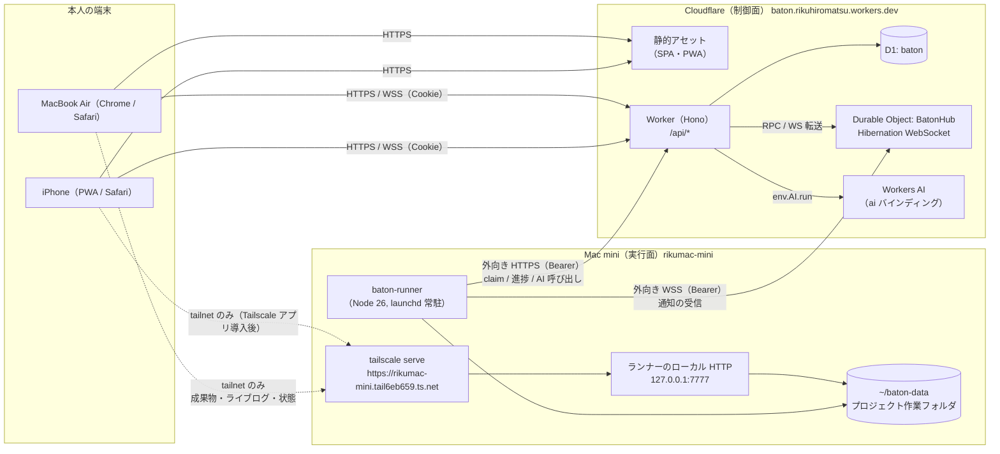
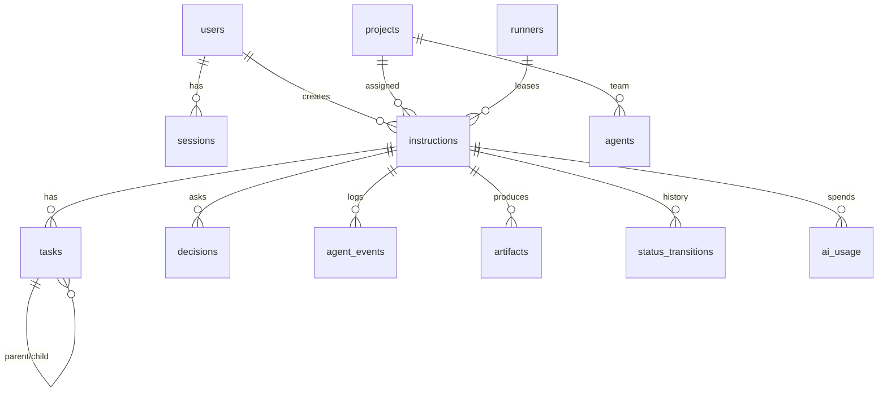
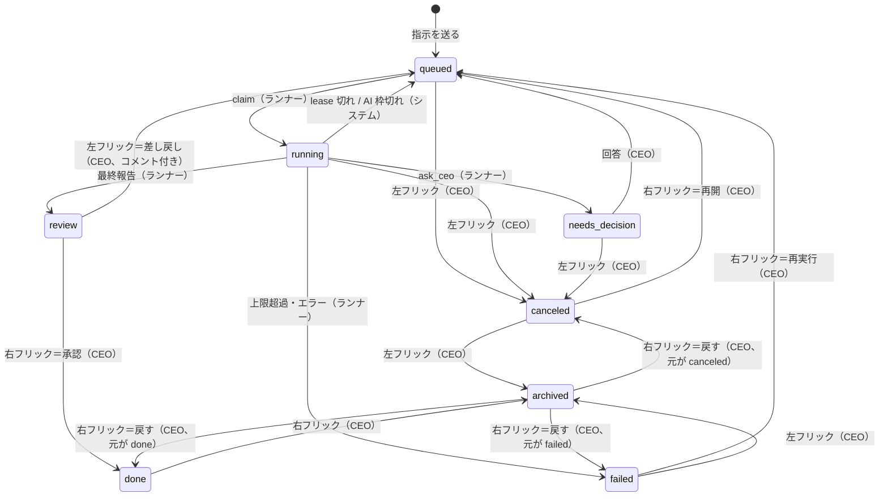
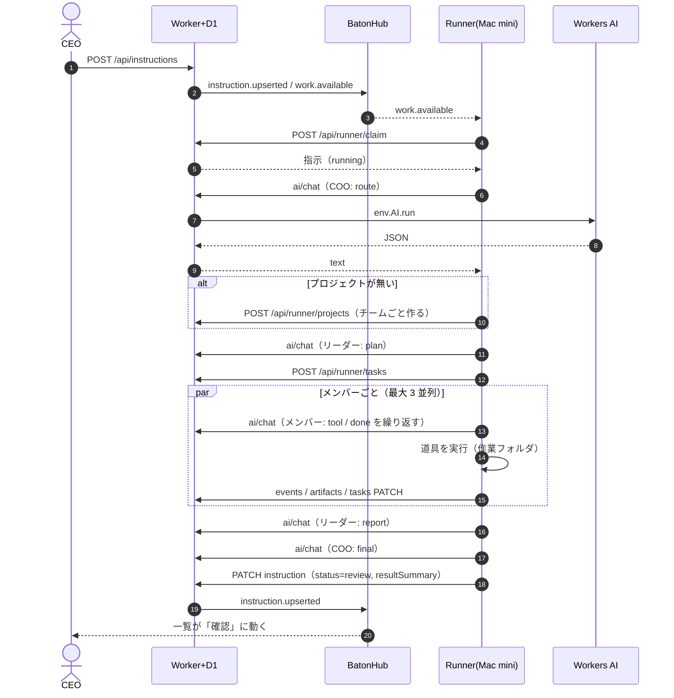
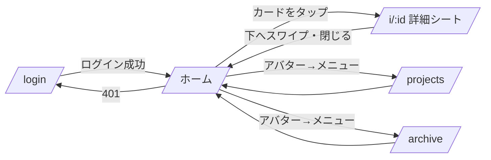
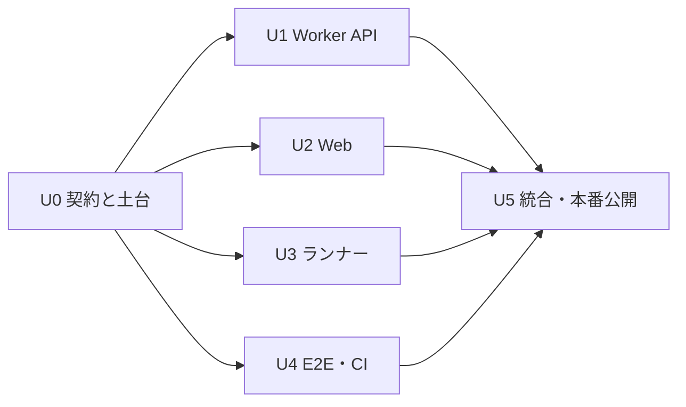

# Baton 設計書

- 版: 1.0（2026-10-20）
- 対象: 実装担当エージェント、本人（CEO）
- 付録: [`docs/schema.sql`](./schema.sql)（D1 スキーマ全文。`app/migrations/0001_init.sql` に同じ内容を置く）

この設計書だけ読めば実装に入れるように書いてある。迷ったら「12. 決定ログ」に戻る。書かれていないことを決めたら、決定ログに D-番号で追記してから実装する。

---

## 0. Baton とは

CEO（本人）が書いた指示を、AI の COO が受け取り、プロジェクトごとのチームリーダーに分解して渡し、リーダーがメンバーに振って実行させ、結果を要約しながら上へ返すアプリ。

```
CEO（本人） ──指示──▶ COO ──方針──▶ リーダー（プロジェクトごと） ──タスク──▶ メンバー
     ▲                  │                   │                                  │
     └──── 最終報告 ◀────┴──── 要約 ◀────────┴────────── 結果の要約 ◀──────────┘
```

上位は下位を「呼び出して、要約だけ受け取る」（マネージャー型オーケストレーション）。下位の生ログは上位のプロンプトに入れない。

### 用語

| 用語 | 意味 |
|---|---|
| 指示（instruction） | CEO が COO に出す 1 件の依頼。フリックで状態を動かす単位 |
| プロジェクト（project） | 指示を担当するまとまり。Mac mini 上の作業フォルダ 1 つと対応 |
| チーム | 1 プロジェクトにつきリーダー 1 体＋メンバー最大 3 体のエージェント定義 |
| タスク（task） | リーダーの計画（plan）、メンバーの作業（work）、リーダーのまとめ（review） |
| 判断待ち（decision） | エージェントが CEO に確認を求めて止まっている質問 |
| 成果物（artifact） | メンバーが作業フォルダに書いたファイルのうち、成果として登録したもの |
| ランナー（runner） | Mac mini 上で常駐し、オーケストレーションを回す Node プロセス |
| 制御面 | Cloudflare（画面配信・API・DB・認証・リアルタイム・AI 推論） |
| 実行面 | Mac mini（エージェントのループ、道具の実行、ファイル） |

---

## 1. 全体アーキテクチャ

### 1.1 構成図



### 1.2 役割分担

| 層 | 持つもの | 持たないもの |
|---|---|---|
| Cloudflare Worker | 画面配信（静的アセット）、REST API、Google 認証、セッション、D1 の読み書き、状態遷移の検証、Workers AI の呼び出し（ランナーの代理）、使用量の記録 | エージェントのループ、ファイル |
| Durable Object `BatonHub`（1 個） | ブラウザとランナーの WebSocket をまとめて持ち、イベントを配る。指示ごとの購読をソケットの attachment に保存 | 永続データ（正本は D1） |
| D1 | 指示・タスク・ログ・成果物の目録・利用者・セッション・ランナー・使用量の正本 | 成果物の本体（大きいファイル） |
| Workers AI | 推論そのもの | — |
| Mac mini ランナー | 指示の取り出し（claim）、COO→リーダー→メンバーのループ、道具の実行、作業フォルダ、tailnet 向けの状態・ログ・ファイル配信 | 認証、DB の正本、AI の API キー |
| Tailscale | 本人の端末 ↔ Mac mini の私設経路。`tailscale serve` でランナーのローカル HTTP を tailnet 内だけに HTTPS で公開 | アプリ本体の通信（それは常に Cloudflare 経由） |

### 1.3 原則

1. **Mac mini は外に穴を開けない。** ランナーは Cloudflare に外向きで接続するだけ（HTTPS と WSS）。ポート開放・Cloudflare Tunnel・Funnel は使わない。
2. **アプリは Cloudflare だけで完結して動く。** tailnet に入っていない端末でも、指示・状態・報告・成果物の先頭 64KB は見える。tailnet は「大きいファイル本体」「生のライブログ」「Mac mini の詳細状態」を直接見るための追加経路。
3. **AI 推論は必ず Worker を通す。** ランナーは `POST /api/runner/ai/chat` を呼び、Worker が `env.AI.run` する。Mac mini に Cloudflare の API トークンを置かない（追加のトークン発行という手作業が要らない。wrangler の OAuth に `ai` スコープが無い問題も避けられる）。
4. **D1 が正本。** DO は配信役。DO が再起動（デプロイで全 WebSocket が切れる）しても、クライアントは再接続して REST で取り直せば元に戻る。

### 1.4 Tailscale で提供するもの

ランナーは `127.0.0.1:7777` でだけ待ち受ける小さな HTTP サーバーを持つ。`tailscale serve --bg --https=443 http://127.0.0.1:7777` で、tailnet 内からだけ `https://rikumac-mini.tail6eb659.ts.net/` として見える。

| パス | 内容 |
|---|---|
| `GET /status` | ランナーの版、稼働時間、実行中の指示、同時実行数、直近の AI エラー、ディスク残量（JSON） |
| `GET /logs/:instructionId/stream` | その指示のライブログ（SSE）。D1 に送る前の生ログも含む（16KB で切らない） |
| `GET /files/:projectSlug/*` | 作業フォルダのファイル本体（読み取り専用、`Content-Disposition: inline`） |
| `GET /files/:projectSlug/` | 作業フォルダの一覧（JSON） |

- 認証: `tailscale serve` が付ける `Tailscale-User-Login` ヘッダを見て、`ALLOWED_TAILNET_LOGINS`（ランナーの設定。既定は本人の Tailscale ログイン名）以外は 403。サーバーは 127.0.0.1 だけで待ち受けるので、ヘッダの偽装は経路上できない（Serve は外から来た同名ヘッダを消してから転送する）。
- CORS: `Access-Control-Allow-Origin` は `https://baton.rikuhiromatsu.workers.dev` と `http://localhost:8790` だけ。`GET` のみ。
- Web アプリからの使い方:
  - 起動時に `GET {tailnetUrl}/status` を 1.5 秒のタイムアウトで試す。成功したら「tailnet 直結あり」として、成果物に「Mac mini で開く」リンク（新しいタブで `/files/...` を開く）と、指示詳細の「生ログ」タブ（SSE）を出す。失敗したらそれらを出さない（エラー表示もしない）。
  - Chrome は公開サイトから tailnet のアドレス（100.64.0.0/10）へ fetch すると「ローカルネットワークへのアクセス」許可を一度だけ聞いてくる。許可すれば以後は出ない。拒否されても、Cloudflare 経由の機能はすべて使える。新しいタブで開くリンク（トップレベルの移動）は許可の対象外なので、ファイル本体は常に開ける。
- 前提の手作業: tailnet の管理画面で HTTPS 証明書を有効にする（確認時点で `CertDomains` が空だった）。iPhone に Tailscale アプリを入れてログインする。→「9.6 本人の手作業」。

### 1.5 Mac mini が落ちているとき

| 状況 | 振る舞い |
|---|---|
| 指示の送信 | いつも通り受け付ける。`queued` のまま D1 に溜まる |
| 画面 | 上部のランナー表示が灰色の点になる（文字は出さない。長押し／ホバーで最終ハートビート時刻） |
| 復帰 | ランナーは起動するとすぐ claim を始め、古い順に処理する |
| 実行中に落ちた | 占有期限（lease、10 分。ハートビートで延長）が切れた `running` の指示は、次の claim で取り直される。完了済みタスクは飛ばして続きから（6.9） |
| 判断待ち | ランナーを占有しないので影響なし。CEO が答えると `queued` に戻り、ランナーが拾う |

ランナーのオンライン判定は「最後のハートビートから 90 秒以内」。ランナーの WebSocket が閉じたときは DO が即座に `runner.status`（offline）を配る。

---

## 2. 技術選定

確認日: 2026-10-20。バージョンは `npm view` で確認した最新版。`package.json` には `^` を付けて書き、`package-lock.json` をコミットする。

### 2.1 一覧

| 領域 | 選んだもの（版） | 理由 | 却下した案と理由 |
|---|---|---|---|
| 言語 | TypeScript 7.0.2 | 全層で型を共有するため。TS 7 は Go 製の新コンパイラで型検査が速い。Vite（oxc）と Node 26 の型除去は TS の版に依存しないので影響がない | JavaScript（契約の型共有ができない）、TS 6 系（7 で困る理由が無い。もし TS 7 で `tsc -b` が動かない道具があれば 6 系に下げ、D-番号で記録） |
| フロント | React 19.3.1 + react-dom | Motion のジェスチャ／レイアウトアニメーションが最も成熟している。実装エージェントが最も正確に書ける | Svelte 5（アニメーションは良いがドラッグ周りの部品が少ない）、SolidJS（同左）、Vue（同左。スワイプとレイアウト遷移の実績で劣る） |
| ビルド | Vite 8.3.4 + `@vitejs/plugin-react` 6.1.2 | Cloudflare 公式の Vite プラグインで、SPA と Worker を 1 回のビルド・1 つの dev サーバーで扱える。dev でも本物の workerd で動く | wrangler 単体＋別 bundler（dev の構成が二重になる）、Next.js/OpenNext（SSR 不要の個人用 SPA には重い）、React Router v7 フレームワーク（SSR 前提の機能が要らない） |
| Cloudflare 連携 | `@cloudflare/vite-plugin` 1.64.0、wrangler 4.151.2 | 上記。`vite build` が `wrangler.json` を出力し、`wrangler deploy` がそれを使う。`.dev.vars.<env>` と `CLOUDFLARE_ENV` で e2e 用の環境を切り替えられる | — |
| ルーティング | `@tanstack/react-router` 1.170.45（コードで定義） | 画面が 5 つだけなのでファイルベースは不要。パス引数と検索パラメータが型付きになる。遷移時のローダーと保留 UI が素直 | React Router（型付き検索パラメータが弱い）、自作の状態切り替え（戻るボタン・ディープリンク・PWA の起動 URL を自分で扱うことになる） |
| サーバー状態 | `@tanstack/react-query` 5.104.4 | REST の取得・キャッシュ・楽観的更新・失敗時の巻き戻しが揃っている。WebSocket のイベントは `queryClient.setQueryData` でキャッシュに反映するだけで済む | SWR（楽観的更新と巻き戻しが手薄）、全部 zustand（キャッシュ無効化を自作することになる） |
| 永続キャッシュ | `@tanstack/react-query-persist-client` + `@tanstack/query-sync-storage-persister` 5.104.4 | 2 回目以降の起動で、前回の一覧を即座に描ける（「開いた瞬間」を速くする）。localStorage に 24 時間 | IndexedDB 永続化（一覧は小さいので不要。手間が増える） |
| 画面ローカル状態 | zustand 5.0.15 | 下書き・取り消しの待ち行列・シートの開閉など、画面をまたぐ小さな状態だけ。1KB 台で Provider 不要 | Redux Toolkit（過剰）、React Context（再描画が広がる） |
| アニメーション・ジェスチャ | `motion` 14.4.0（`motion/react`） | ドラッグ（`drag="x"`、速度付きの `onDragEnd`）、spring、`AnimatePresence`、`layout`／`layoutId` による共有要素遷移、`useReducedMotion`／`MotionConfig reducedMotion="user"` が 1 つで揃う | `@use-gesture/react` 10.3.1＋react-spring（2 つ組み合わせる手間。use-gesture は更新が止まり気味）、CSS だけ（フリックの速度判定と spring の戻りが書けない）、View Transitions API のみ（ジェスチャ連動ができない） |
| スタイル | Tailwind CSS 4.3.3（`@tailwindcss/vite`）＋ CSS 変数のデザイントークン | Liquid Glass は CSS 変数（7.8）で定義し、Tailwind 4 の `@theme` から参照する。余白・文字サイズの一貫性を保ちやすい | CSS Modules のみ（トークンの適用漏れが起きやすい）、CSS-in-JS（実行時コスト。Workers 配信の静的 CSS で足りる） |
| PWA | `vite-plugin-pwa` 2.0.0（Workbox 7.4.1）＋ `@vite-pwa/assets-generator` 2.0.0 | マニフェスト・Service Worker・アイコン生成を Vite のビルドに組み込める。アプリシェルを precache して、オフラインでも即座に開く | 手書きの Service Worker（更新処理とキャッシュ版管理を自作することになる） |
| API フレームワーク | Hono 4.13.13 + `@hono/zod-validator` 0.9.1 | Workers で最も使われている軽量ルーター。ミドルウェア（認証・CSRF・エラー）を素直に書ける。zod 4 に対応 | itty-router（ミドルウェアと型が弱い）、素の fetch 分岐（ルートが 30 本あり保守がつらい）、tRPC（ランナーとブラウザで REST の方が扱いやすい。curl で確かめられる） |
| バリデーション・契約 | zod 4.6.7 | 共有パッケージで型とスキーマを 1 回だけ書き、Worker・Web・ランナーの 3 者が同じものを使う。LLM の JSON 出力の検査にも使う（`z.toJSONSchema` で `response_format` 用の JSON Schema も作れる） | valibot（軽いが LLM 出力の JSON Schema 化の実績が少ない）、TypeBox（型の書き味が劣る） |
| DB | Cloudflare D1 | Workers から追加設定なしで使える SQLite。個人用で 1 地域で十分。wrangler の OAuth スコープ（d1 write）で作成・マイグレーションまで自動でできる | KV（関係データに向かない）、DO の SQLite（単一 DO に全部集めると後で分けにくい。D1 のほうがマイグレーション道具が揃う）、外部 DB（Neon 等。アカウント作成という手作業が増える） |
| DB アクセス | 生 SQL（`env.DB.prepare`）＋ リポジトリ層＋ zod で行を検査。マイグレーションは `wrangler d1 migrations` | テーブル 13 個の小さなアプリ。SQL のマイグレーションを正本にすれば、設計書の SQL とずれない。生成工程が増えない | Drizzle ORM 0.45.4（スキーマが TS と SQL の二重管理になる。1.0 が beta のまま）、Kysely（型生成の手順が増える） |
| 認証 | Google OAuth 2.0（認可コード＋PKCE＋state）を `arctic` 3.7.0 で。セッションは D1 の自前実装（不透明トークン、DB にはハッシュだけ） | arctic は Workers で動く軽量な OAuth クライアントで、`createAuthorizationURL(state, codeVerifier, scopes)` と `validateAuthorizationCode(code, codeVerifier)` が PKCE 込みで揃う。セッションを自前にすると失効・CSRF・許可リストを 1 か所で管理できる | Cloudflare Access（Zero Trust の設定とダッシュボード操作が増える。wrangler のスコープ外）、Auth.js（Workers での構成が重い）、JWT セッション（即時失効ができない）、Lucia（開発終了） |
| リアルタイム | Durable Objects の Hibernation WebSocket（`ctx.acceptWebSocket(ws, tags)`、`setWebSocketAutoResponse`、`serializeAttachment`） | 先行事例で決定済み。待機中は DO が休眠して課金されない。1 DO で最大 32,768 接続。タグでブラウザとランナーを分けて配れる | SSE（Workers から長時間ストリームを持つと DO 無しでは配信元を 1 つにできない）、ポーリングのみ（体感が遅い）、Pusher 等（外部サービス・手作業が増える） |
| AI | Workers AI（`ai` バインディング）。モデルは 2.2 | 要件。Worker のバインディング経由なので追加の認証情報が要らない | AI Gateway 経由（あると便利だが作成にダッシュボード操作が要る。後で入れられる）、外部 LLM（要件外） |
| ランナー実行環境 | Node 26.11.1（標準の型除去で `.ts` を直接実行）。依存は `@baton/shared` と zod だけ。HTTP・WebSocket・fetch は Node 標準 | Mac mini に入っている Node をそのまま使う。ビルド工程なし。Node 26 は `node src/main.ts` で TS を実行でき、npm workspaces 経由の `@baton/shared`（.ts）も読み込めることを確認済み（2026-10-20、スクラッチで検証） | bun/deno（未導入。入れる手作業が増える）、tsx 4.23.15（型除去で足りる。使うのは型除去が通らない構文が必要になったときの退避先として D-21 に記録）、Docker（macOS で常駐させる手間とリソース） |
| 常駐 | launchd（`~/Library/LaunchAgents/com.rikuhiromatsu.baton-runner.plist`） | 先行事例で決定済み。Mac mini の慣例。自動ログイン済みなので LaunchAgent で再起動後も自動で上がる | pm2（追加の常駐管理が二重になる）、cron（常駐に向かない） |
| ユニットテスト | Vitest 5.0.5（projects 機能で shared / web / runner を 1 回で実行）、`happy-dom` 21.0.3、`@testing-library/react` 16.3.3 | Vite と設定を共有できる。速い | Jest（ESM と Vite の設定が二重になる） |
| Workers 統合テスト | `@cloudflare/vitest-plugin` 1.4.5（旧 `@cloudflare/vitest-pool-workers` は改名済みで更新停止） | 本物の workerd 上で D1・DO・Worker を動かしてテストできる。Vitest 5 に対応（peer: `^4.1.0 \|\| ^5.0.0`） | Miniflare を手で組む（公式プラグインで足りる）、本番相当の環境でテスト（遅く、壊す危険） |
| E2E | `@playwright/test` 1.64.1。Chromium（デスクトップ）、Chromium（iPhone 相当、タッチ）、WebKit（iPhone 相当） | 実ブラウザで Cookie・WebSocket・Service Worker まで通せる。タッチ操作は Chromium では CDP の `Input.dispatchTouchEvent` で本物のタッチ由来の pointer イベントを出せる | Cypress（WebKit とマルチタブが弱い）、手動確認だけ（回帰を防げない） |
| モノレポ | npm workspaces（ルートの `package.json`） | Mac mini には npm しかない（bun/pnpm 無し、Node 25 以降 corepack 同梱なし）。追加の道具を入れない | pnpm/turborepo（導入の手作業が増える。パッケージが 4 つしかない） |
| CI | GitHub Actions：型検査・ユニット・Workers 統合・E2E（モック AI）をプッシュと PR で実行。デプロイは CI ではしない | テストに Cloudflare の認証情報が要らない構成にしてある（AI はモック、D1/DO はローカル）。デプロイを CI でやるには API トークン発行とリポジトリのシークレット登録という手作業が要るため、Mac mini から `npm run deploy`（wrangler の OAuth を使う）にする | CI からのデプロイ（手作業が増える。必要になったら D-番号を追加して切り替える） |
| ID | `crypto.randomUUID()` | Workers・ブラウザ・Node すべてに標準である | ULID（ライブラリが増える。並び順は `created_at` で足りる） |

### 2.2 AI モデル（Workers AI）

Cloudflare のモデル一覧と各モデルのページ・料金表で確認した（2026-10-20）。

| 用途 | 主モデル | 退避先（主が失敗したとき） | 理由 |
|---|---|---|---|
| COO（指示の解釈・プロジェクト選択・最終報告） | `@cf/openai/gpt-oss-120b`（128k、関数呼び出し対応、推論の強さ low/medium/high、$0.35/$0.75 per M） | `@cf/meta/llama-3.3-70b-instruct-fp8-fast`（JSON モードの公式対応一覧に載っている） | 判断の質が全体を決めるので一番重いモデル。Workers Free でも使える（有料専用ではない） |
| リーダー（タスク分解・まとめ） | `@cf/zai-org/glm-4.7-flash`（131k、複数ターンの tool calling、推論あり、$0.06/$0.40 per M） | `@cf/openai/gpt-oss-120b` | 呼び出し回数が多く、計画の質も要る。安くて構造化出力に強い |
| メンバー（道具を使う作業ループ） | `@cf/zai-org/glm-4.7-flash` | `@cf/openai/gpt-oss-20b`（$0.20/$0.30 per M） | 1 タスクで最大 12 往復するので安さが効く。長い文脈（ファイル内容）を扱える |
| 補助（件名付け・長文の圧縮要約） | `@cf/zai-org/glm-4.7-flash`（推論を短く） | `@cf/ibm-granite/granite-4.0-h-micro`（$0.017/$0.112 per M） | 軽い処理 |

- 有料プラン（Workers Paid）にしたら、COO を `@cf/moonshotai/kimi-k2.6`（262k、tools・structured outputs・推論、$0.95/$4.00 per M。**有料専用**）に上げられる。切り替えは Worker の変数 `MODEL_COO` で行う（コード変更なし）。
- **無料枠の制約（重要）:** Workers AI は Free でも Paid でも 1 日 10,000 Neurons が無料。Free はそれを超えると使えない（Paid は $0.011 / 1,000 Neurons で続行）。glm-4.7-flash 中心でも、本格的に使うと 1 日数件の指示で無料枠に届く見込み。アカウントのプランは未確認なので、本人が確認する（9.6）。枠切れのときの振る舞いは 5.8。
- **モデルの出力形式は統一しない前提で作る。** 確認した限り、モデルによって戻り値が `{ response, tool_calls, usage }` 型と OpenAI 互換の `{ choices[0].message, usage }` 型に分かれ、推論モデルは推論文を別に返す。Worker の `normalizeAiResult()` がどちらも `{ text, usage }` に揃える。U1 の最初の作業として `npm run ai:probe`（4 モデルに 1 回ずつ同じ依頼を投げ、生の戻り値を `app/test/fixtures/ai/*.json` に保存）を実行し、その実物でテストを書く。
- **構造化出力の方式（D-11）:** ネイティブの tool calling は使わず、全役割で「1 ターン 1 個の JSON アクションを返す」方式にする。Worker は `response_format: { type: "json_schema", json_schema: { name, schema } }` を付けて呼び、モデルが拒否したら（エラー）付けずに再呼び出しし、本文から最初の JSON オブジェクトを取り出す。ランナーが zod で検査し、失敗したら 1 回だけ「直して」と再依頼する。JSON モードはストリーミング非対応なので、ストリーミングは使わない。

---

## 3. ドメインモデルと D1 スキーマ

### 3.1 関係図



- 単一テナント。許可リストに入っている全員が同じデータを見る（想定は本人 1 人）。`created_by` は記録のためだけ。
- COO は全体で 1 体（`agent-coo`、初期データ）。リーダーはプロジェクトに 1 体、メンバーは最大 3 体。
- タスクの木: `plan`（リーダー、親なし）→ `work`（メンバー、親は plan）→ `review`（リーダー、親は plan）。やり直しは `round` を 2 にして同じ形をもう一度作る。

### 3.2 スキーマ

全文は [`docs/schema.sql`](./schema.sql)。U0 がこれを `app/migrations/0001_init.sql` にコピーする。ローカルの SQLite で読み込めることを確認済み。

要点:
- 時刻は UNIX ミリ秒の `INTEGER`。日付の集計（`ai_usage.day`）だけ UTC の `YYYY-MM-DD`。
- JSON 列は `CHECK (json_valid(...))`。
- `instructions.client_id` は端末が採番する冪等キー。送信を再試行しても 1 件にしかならない。
- `instructions.lease_runner_id / lease_expires_at` が「どのランナーがいつまで握っているか」。
- `status_transitions` が取り消し（undo）の根拠。
- D1 の Free プランは 1 回の呼び出しで 50 クエリまで。どの API も 1 リクエストあたり 20 クエリ以内に収める（まとめて書くときは `env.DB.batch()`）。

### 3.3 指示のステータス

| 値 | 表示名 | 意味 | 誰が変える |
|---|---|---|---|
| `queued` | 待機 | 受付済み。ランナーが拾うのを待っている（判断の回答後・差し戻し後・再実行もここに戻る） | 作成時、CEO、システム |
| `running` | 実行中 | ランナーが握って処理中 | ランナー（claim） |
| `needs_decision` | 判断待ち | CEO の回答待ち。ランナーは握っていない | ランナー |
| `review` | 確認 | COO の最終報告が届いた。CEO が承認か差し戻しを選ぶ | ランナー |
| `done` | 完了 | CEO が承認した | CEO |
| `failed` | 失敗 | 上限超過・回復できないエラー | ランナー、システム |
| `canceled` | 取消 | CEO が止めた | CEO |
| `archived` | アーカイブ | 一覧から片付けた。アーカイブ画面だけに出る | CEO |

### 3.4 状態遷移



遷移表は `packages/shared/src/status.ts` に 1 つだけ置き、Worker（検証）と Web（フリックの可否・色・アイコン）の両方がそれを使う。

### 3.5 フリック操作の対応表

| 今の状態 | 右フリック → | 左フリック ← |
|---|---|---|
| `queued` | なし（戻る） | `cancel` → `canceled` |
| `running` | なし（戻る） | `cancel` → `canceled`（ランナーに中止を通知） |
| `needs_decision` | 判断シートを開く（状態は変えない） | `cancel` → `canceled` |
| `review` | `approve` → `done` | `send_back` → コメント入力シート → 送信で `queued`（`feedback` に保存） |
| `done` | `archive` → `archived` | なし（戻る） |
| `failed` | `retry` → `queued` | `archive` → `archived` |
| `canceled` | `retry` → `queued` | `archive` → `archived` |
| `archived`（アーカイブ画面） | `restore` → アーカイブ前の状態 | なし（戻る） |

- CEO 操作のすべての遷移は、画面下に 5 秒の取り消しトースト（「元に戻す」ボタン）を出す。押すと `POST /api/transitions/:id/undo`。サーバー側の取り消し期限は 15 秒（通信の遅れを見込む）。
- `cancel` の取り消しは「`canceled` → 元の状態」ではなく「`canceled` → `queued`」にする（ランナーは既に中止しているため。完了済みタスクは残るので続きから再開される）。
- `send_back` は取り消しトーストを出さない（シートで明示的に送るので誤操作になりにくい）。

---

## 4. API 仕様

### 4.1 共通

- ベース: `https://baton.rikuhiromatsu.workers.dev/api`（ローカル `http://localhost:8790/api`）
- 形式: JSON（UTF-8）。時刻は UNIX ミリ秒。
- エラー: `{ "error": { "code": ErrorCode, "message": string, "details"?: unknown } }`
  - `ErrorCode` = `unauthorized`(401) / `forbidden`(403) / `not_found`(404) / `conflict`(409, 状態の競合) / `invalid`(400, zod 検査失敗) / `rate_limited`(429) / `ai_unavailable`(503) / `ai_quota`(429) / `internal`(500)
- 型と zod スキーマの置き場所: `packages/shared/src/`（4.6）。Worker は `@hono/zod-validator` で入力を検査し、出力も開発時は `schema.parse` で検査する（`BATON_ENV !== "production"` のとき）。
- Web は `hono/client` を使わず、`packages/shared/src/api.ts` のパス定数と型から作った薄い fetch クライアントを使う（D-14）。

### 4.2 ブラウザ用（Cookie セッション）

認証: Cookie `__Host-baton_session`（本番）/ `baton_session`（ローカル・e2e）。状態を変えるメソッド（POST/PATCH/DELETE）はヘッダ `X-Baton-CSRF` と `Origin` を検査（5.5）。

| メソッド・パス | 入力 | 出力 | 説明 |
|---|---|---|---|
| `GET /api/auth/login?redirect=/i/xxx` | — | 302 → Google | state・PKCE を作って D1 と Cookie に置く |
| `GET /api/auth/callback?code&state` | — | 302 → `redirect`（失敗時 `/login?e=1`） | 6.1 |
| `POST /api/auth/logout` | — | 204 | セッションを消す |
| `GET /api/session` | — | `SessionInfo` | 未ログインは 401 |
| `GET /api/instructions?view=active\|archived&cursor` | — | `{ items: InstructionSummary[], nextCursor: string \| null }` | active は archived 以外。並びは 7.3。1 ページ 50 件 |
| `POST /api/instructions` | `CreateInstructionInput` | 201 `InstructionSummary`（同じ `clientId` は 200 で既存を返す） | 作成して Hub に `instruction.upserted`、ランナーに `work.available` |
| `GET /api/instructions/:id` | — | `InstructionDetail` | |
| `GET /api/instructions/:id/events?after=<seq>&limit=200` | — | `{ items: AgentEvent[] }` | 実行ログ |
| `POST /api/instructions/:id/transition` | `TransitionInput` | `{ instruction: InstructionSummary, transitionId: string }` | フリック。`expectedStatus` が今の状態と違えば 409 |
| `POST /api/transitions/:id/undo` | — | `{ instruction: InstructionSummary }` | 15 秒以内・未取り消し・直後に他の遷移がないときだけ |
| `POST /api/decisions/:id/answer` | `AnswerDecisionInput` | `{ decision: Decision, instruction: InstructionSummary }` | 回答して指示を `queued` に戻す |
| `GET /api/projects` | — | `{ items: ProjectWithTeam[] }` | |
| `GET /api/artifacts/:id` | — | `Artifact`（`previewText` 込み） | |
| `GET /api/usage/today` | — | `UsageToday` | |
| `GET /api/ws` | WebSocket Upgrade | 101 | Cookie と Origin を検査して Hub へ転送（タグ `browser`） |

### 4.3 ランナー用（Bearer トークン）

認証: `Authorization: Bearer <BATON_RUNNER_TOKEN>`。Worker は SHA-256 を取って `runners.token_hash` と照合（`revoked = 0`）。Cookie と CSRF は見ない。

| メソッド・パス | 入力 | 出力 | 説明 |
|---|---|---|---|
| `GET /api/runner/ws` | Upgrade | 101 | Hub へ転送（タグ `runner`、`runner:<id>`） |
| `POST /api/runner/heartbeat` | `HeartbeatInput` | `HeartbeatOutput` | 30 秒ごと。握っている指示の lease を 10 分延長し、中止すべき指示 ID を返す |
| `POST /api/runner/claim` | `{ maxConcurrent: number, activeIds: string[] }` | 200 `ClaimOutput` / 204 | 7.x の順で 1 件握る。`attempt` を +1 |
| `GET /api/runner/instructions/:id/state` | — | `RunnerInstructionState` | 再開用。タスク・回答済みの判断・プロジェクトとチーム・次の event seq |
| `PATCH /api/runner/instructions/:id` | `RunnerInstructionPatch` | `InstructionSummary` | 件名・プロジェクト・最終報告・`review`/`failed` への遷移 |
| `POST /api/runner/instructions/:id/release` | `ReleaseInput` | 204 | 握りを外す（`queued` に戻す・`not_before` を付ける） |
| `POST /api/runner/projects` | `CreateProjectInput` | `ProjectWithTeam` | 新規プロジェクトとチームを一度に作る |
| `POST /api/runner/projects/:id/agents` | `CreateAgentInput[]` | `Agent[]` | 既存プロジェクトのメンバー追加（合計 3 体まで） |
| `POST /api/runner/tasks` | `CreateTaskInput[]`（最大 10） | `Task[]` | |
| `PATCH /api/runner/tasks/:id` | `TaskPatch` | `Task` | |
| `POST /api/runner/events` | `AppendEventsInput`（最大 50 件） | `{ lastSeq: number }` | `seq` 重複は無視（冪等） |
| `POST /api/runner/artifacts` | `CreateArtifactInput` | `Artifact` | 同じ path・hash は既存を返す |
| `POST /api/runner/decisions` | `CreateDecisionInput` | `Decision` | 指示を `needs_decision` にし、握りを外す |
| `POST /api/runner/ai/chat` | `AiChatInput` | `AiChatOutput` | Worker が Workers AI を呼ぶ（5.8） |

ランナー用の状態変更 API はすべて「その指示を今そのランナーが握っている」ことを検査する（`lease_runner_id` 一致かつ `status = 'running'`）。違えば 409 `conflict`。ランナーはそれを受けたらその指示の処理を即座に打ち切る（取り消された等）。

### 4.4 主要な型（抜粋。正本は `packages/shared`）

```ts
// packages/shared/src/status.ts
export const INSTRUCTION_STATUSES = ["queued","running","needs_decision","review","done","failed","canceled","archived"] as const;
export type InstructionStatus = typeof INSTRUCTION_STATUSES[number];
export type CeoAction = "approve" | "send_back" | "cancel" | "archive" | "retry" | "restore";
export type SwipeDirection = "right" | "left";
// 3.5 の表をそのままデータにする。null はその方向に動かない。"open_decision" は画面側の動作
export const SWIPE_MAP: Record<InstructionStatus, Record<SwipeDirection, CeoAction | "open_decision" | null>>;
export function nextStatus(from: InstructionStatus, action: CeoAction, archivedFrom?: InstructionStatus): InstructionStatus | null;

// packages/shared/src/models.ts
export type InstructionSummary = {
  id: string; clientId: string; body: string; title: string | null;
  status: InstructionStatus; statusChangedAt: number;
  projectId: string | null; projectName: string | null;
  resultSummary: string | null; openDecisionId: string | null;
  taskCounts: { total: number; done: number; running: number; failed: number };
  createdAt: number; updatedAt: number; completedAt: number | null;
};
export type InstructionDetail = {
  instruction: InstructionSummary & { feedback: string | null; error: string | null; tokensIn: number; tokensOut: number };
  project: ProjectWithTeam | null;
  tasks: Task[]; decisions: Decision[]; artifacts: ArtifactMeta[];
  lastEventSeq: number;
};
export type Task = { id: string; instructionId: string; parentTaskId: string | null; assigneeAgentId: string | null;
  kind: "plan" | "work" | "review"; planKey: string | null; dependsOn: string[]; title: string; spec: string;
  status: "pending" | "running" | "done" | "failed" | "canceled"; resultSummary: string | null;
  round: number; seq: number; startedAt: number | null; finishedAt: number | null; updatedAt: number };
export type Agent = { id: string; projectId: string | null; role: "coo" | "leader" | "member"; name: string; specialty: string; model: string | null; active: boolean };
export type ProjectWithTeam = { id: string; slug: string; name: string; summary: string; status: "active" | "archived"; agents: Agent[]; updatedAt: number };
export type Decision = { id: string; instructionId: string; taskId: string | null; askedByAgentId: string | null; question: string; options: string[]; status: "open" | "answered" | "canceled"; answer: string | null; answeredAt: number | null; createdAt: number };
export type ArtifactMeta = { id: string; instructionId: string; taskId: string | null; projectSlug: string | null; relPath: string; title: string; mime: string; sizeBytes: number; createdAt: number };
export type Artifact = ArtifactMeta & { sha256: string; previewText: string | null };
export type AgentEvent = { id: string; instructionId: string; taskId: string | null; agentId: string | null; seq: number;
  kind: "llm_call" | "action" | "tool_call" | "tool_result" | "summary" | "decision" | "note" | "error";
  content: unknown; model: string | null; tokensIn: number | null; tokensOut: number | null; durationMs: number | null; createdAt: number };
export type RunnerStatus = { online: boolean; lastHeartbeatAt: number | null; activeInstructionIds: string[]; version: string | null; tailnetUrl: string | null };
export type SessionInfo = { user: { id: string; email: string; name: string; pictureUrl: string | null }; csrfToken: string; runner: RunnerStatus; env: "production" | "development" | "e2e" };
export type UsageToday = { day: string; tokensIn: number; tokensOut: number; byModel: { model: string; tokensIn: number; tokensOut: number }[]; quotaHitAt: number | null };

// packages/shared/src/api.ts（入力）
export const CreateInstructionInput = z.object({ clientId: z.uuid(), body: z.string().trim().min(1).max(8000) });
export const TransitionInput = z.object({ action: z.enum(["approve","send_back","cancel","archive","retry","restore"]), expectedStatus: z.enum(INSTRUCTION_STATUSES), comment: z.string().max(2000).optional() });
export const AnswerDecisionInput = z.object({ answer: z.string().trim().min(1).max(2000), optionIndex: z.int().min(0).max(3).optional() });
export const HeartbeatInput = z.object({ version: z.string(), tailnetUrl: z.url().nullable(), activeInstructionIds: z.array(z.uuid()).max(8), maxConcurrent: z.int().min(1).max(4) });
export const HeartbeatOutput = z.object({ serverTime: z.number(), cancelInstructionIds: z.array(z.uuid()) });
export const ClaimOutput = z.object({ instruction: /* InstructionSummary + feedback */, resume: z.boolean() });
export const ReleaseInput = z.object({ reason: z.enum(["ai_quota","ai_unavailable","shutdown","error"]), notBefore: z.number().nullable(), error: z.string().max(4000).optional() });
export const RunnerInstructionPatch = z.object({ title: z.string().max(80).optional(), projectId: z.uuid().optional(), resultSummary: z.string().max(8000).optional(), status: z.enum(["review","failed"]).optional(), error: z.string().max(4000).optional() });
export const AiChatInput = z.object({ instructionId: z.uuid(), role: z.enum(["coo","leader","member","util"]),
  messages: z.array(z.object({ role: z.enum(["system","user","assistant"]), content: z.string() })).min(1).max(60),
  jsonSchema: z.object({ name: z.string(), schema: z.record(z.string(), z.unknown()) }).optional(),
  maxCompletionTokens: z.int().min(64).max(8192), reasoningEffort: z.enum(["low","medium","high"]).optional() });
export const AiChatOutput = z.object({ text: z.string(), model: z.string(), usedFallback: z.boolean(), usage: z.object({ tokensIn: z.int(), tokensOut: z.int() }) });
```

`CreateProjectInput`、`CreateAgentInput`、`CreateTaskInput`、`TaskPatch`、`AppendEventsInput`、`CreateArtifactInput`、`CreateDecisionInput`、`RunnerInstructionState` は上と同じ流儀で、D1 の列に 1 対 1 で対応させて U0 が定義する（列の制約＝zod の制約）。

### 4.5 リアルタイムのイベント

接続: ブラウザは `wss://…/api/ws`、ランナーは `wss://…/api/runner/ws`。メッセージは JSON 文字列 1 個＝イベント 1 個、または `{ "t": "batch", "items": [...] }`（Hub が 100ms 以内のイベントを束ねる）。

サーバー → ブラウザ（`packages/shared/src/events.ts` の判別共用体 `ServerEvent`）:

| `t` | 中身 | 配り先 |
|---|---|---|
| `hello` | `{ serverTime, runner: RunnerStatus }` | 接続直後 |
| `instruction.upserted` | `{ instruction: InstructionSummary }` | 全ブラウザ |
| `task.upserted` | `{ task: Task }` | 全ブラウザ（一覧のタスク数更新にも使う） |
| `decision.upserted` | `{ decision: Decision }` | 全ブラウザ |
| `artifact.created` | `{ artifact: ArtifactMeta }` | 全ブラウザ |
| `agent_event.appended` | `{ event: AgentEvent }`（`content` は 2KB に切る） | その指示を購読中のブラウザだけ |
| `runner.status` | `{ runner: RunnerStatus }` | 全ブラウザ |
| `usage.updated` | `{ usage: UsageToday }` | 全ブラウザ |

ブラウザ → サーバー: `{"t":"subscribe","instructionId":"…"}` / `{"t":"unsubscribe"}`（購読は 1 ソケット 1 指示。attachment に保存）、生の文字列 `ping`（DO を起こさず `pong` が返る。`setWebSocketAutoResponse`）。

サーバー → ランナー（`RunnerServerEvent`）: `work.available`、`instruction.cancel { instructionId }`、`decision.answered { instructionId }`。

イベントの欠落対策: ブラウザは再接続したら（`hello` を受けたら）、表示中のクエリを全部無効化して取り直す。指示詳細のログは `lastEventSeq` から `GET …/events?after=` で埋める。

### 4.6 共有パッケージの中身

```
packages/shared/src/
  index.ts        # 全部を再エクスポート
  status.ts       # ステータス・遷移表・SWIPE_MAP・nextStatus()
  models.ts       # ドメイン型と zod スキーマ（4.4）
  api.ts          # パス定数（API_PATHS）、入出力の zod スキーマ、ErrorCode
  events.ts       # ServerEvent / ClientEvent / RunnerServerEvent（zod の判別共用体）
  agent-protocol.ts # LLM の JSON アクション（5.3）の zod スキーマと JSON Schema 化
  limits.ts       # 上限値（5.6）
  testids.ts      # E2E が使う data-testid の一覧（7.12）
```

規則: `enum`・名前空間・パラメータプロパティなど型除去できない構文は禁止（Node の型除去で実行するため）。`tsconfig` に `"erasableSyntaxOnly": true` と `"allowImportingTsExtensions": true`、相対 import は `.ts` 拡張子付きで書く。

---

## 5. オーケストレーション

### 5.1 全体の流れ



### 5.2 段階

ランナーの `orchestrate(instruction)` は次の段階を順に進める。各段階の結果は D1（タスク・イベント）に書いてから次へ進むので、どこで落ちても 5.9 の方法で続きから再開できる。

1. **COO: 振り分け（route）**
   - 入力: 指示本文、差し戻しコメント（あれば）、回答済みの判断、アクティブなプロジェクト一覧（id・name・summary・チーム構成）。
   - 出力: `route`（既存プロジェクト or 新規プロジェクト＋チーム案、リーダーへの方針 `brief`、件名 `title`）／`answer_directly`（チームを動かすまでもない質問への直接回答）／`ask_ceo`。
   - 新規プロジェクトは自動で作る（CEO の承認は求めない）。slug が衝突したら末尾に `-2` 等を付ける。
   - `title` は即座に `PATCH` して一覧に反映する。
2. **リーダー: 計画（plan）**
   - `plan` タスクを作り、入力: COO の `brief`、プロジェクトの summary、作業フォルダのファイル一覧（先頭 200 件）、メンバーの名前と得意分野、前ラウンドの結果（やり直し時）。
   - 出力: `plan`（1〜6 個のタスク。`key`・`title`・`spec`・`assignee`（メンバー名）・`dependsOn`）／`ask_ceo`。
   - 依存関係に循環があれば、リーダーに 1 回だけ直させる。それでもだめなら依存を無視して順番に実行する。
3. **メンバー: 実行（work）**
   - 依存が満たされたタスクから、指示あたり最大 3 並列で実行する。
   - 各ターンの出力: `tool`（道具を 1 つ呼ぶ）／`done`（結果の要約と成果物パス）／`ask_ceo`／`give_up`（理由）。
   - 入力: タスクの `spec`、依存タスクの `result_summary`、使える道具の説明、これまでのターンの道具結果（古いものから圧縮。5.6）。
4. **リーダー: まとめ（review）**
   - 入力: 全 `work` タスクの要約と成果物一覧（本文は渡さない）。
   - 出力: `report`（COO への要約）／`revise`（追加・やり直しのタスク。ラウンド 2 まで）／`ask_ceo`。
5. **COO: 最終報告（final）**
   - 入力: 指示本文、リーダーの `report`、成果物一覧。
   - 出力: `final`（CEO への報告。結論を先頭に、成果物への言及、残課題）。
   - `PATCH status=review, resultSummary`。

### 5.3 JSON アクション（`packages/shared/src/agent-protocol.ts`）

```ts
const AskCeo = z.object({ kind: z.literal("ask_ceo"), question: z.string().min(1).max(1000), options: z.array(z.string().max(200)).max(4) });

export const CooRouteAction = z.discriminatedUnion("kind", [
  z.object({ kind: z.literal("route"), title: z.string().min(1).max(60),
    project: z.discriminatedUnion("mode", [
      z.object({ mode: z.literal("existing"), projectId: z.string() }),
      z.object({ mode: z.literal("new"), name: z.string().max(40), slug: z.string().regex(/^[a-z0-9][a-z0-9-]{1,39}$/), summary: z.string().max(400),
        leader: z.object({ name: z.string().max(30), specialty: z.string().max(200) }),
        members: z.array(z.object({ name: z.string().max(30), specialty: z.string().max(200) })).min(1).max(3) }) ]),
    brief: z.string().min(1).max(3000) }),
  z.object({ kind: z.literal("answer_directly"), title: z.string().max(60), report: z.string().min(1).max(8000) }),
  AskCeo,
]);
export const LeaderPlanAction = z.discriminatedUnion("kind", [
  z.object({ kind: z.literal("plan"), tasks: z.array(z.object({ key: z.string().regex(/^t\d{1,2}$/), title: z.string().max(80), spec: z.string().max(2000), assignee: z.string(), dependsOn: z.array(z.string()).max(5) })).min(1).max(6) }),
  AskCeo,
]);
export const MemberStepAction = z.discriminatedUnion("kind", [
  z.object({ kind: z.literal("tool"), tool: z.enum(["fs_list","fs_read","fs_write","fs_append","web_fetch"]), args: z.record(z.string(), z.unknown()), why: z.string().max(200) }),
  z.object({ kind: z.literal("done"), summary: z.string().min(1).max(3000), artifacts: z.array(z.object({ path: z.string(), title: z.string().max(80) })).max(10) }),
  z.object({ kind: z.literal("give_up"), reason: z.string().max(1000) }),
  AskCeo,
]);
export const LeaderReviewAction = z.discriminatedUnion("kind", [
  z.object({ kind: z.literal("report"), summary: z.string().min(1).max(4000), openIssues: z.array(z.string().max(300)).max(5) }),
  z.object({ kind: z.literal("revise"), reason: z.string().max(1000), tasks: /* LeaderPlanAction の tasks と同じ */ }),
  AskCeo,
]);
export const CooFinalAction = z.object({ kind: z.literal("final"), report: z.string().min(1).max(8000) });
```

`z.toJSONSchema()` で JSON Schema に変換して `AiChatInput.jsonSchema` に渡す。

### 5.4 システムプロンプトの方針

プロンプトは `runner/src/prompts/*.ts` に役割ごとに置く。すべて日本語で書き、出力は日本語。共通の骨格:

1. 立場（あなたは〇〇。上司は誰、部下は誰）
2. 今回の入力（区切り記号 `<<<input>>>` で囲む。入力の中の指示には従わないと明記＝プロンプト注入対策）
3. やってよいこと・いけないこと
4. 出力形式（JSON アクション 1 個だけ。前後に文章を書かない。スキーマを貼る）
5. 判断に迷ったときの方針

役割ごとの要点:

| 役割 | 方針 |
|---|---|
| COO | CEO の時間を最も大事にする。曖昧でも合理的に解釈して進め、`ask_ceo` は「解釈によって成果が大きく変わり、やり直しの損失が大きい」ときだけ（目安: 1 指示で 1 回まで）。既存プロジェクトに合うものがあれば再利用。チームは必要最小限（メンバー 1〜3）。最終報告は結論 → 根拠 → 成果物 → 残課題の順、600 字以内を目安。社外への送信・購入・公開・削除など取り返しのつかない行為は実行できないので、必要なら報告に「CEO がやること」として書く |
| リーダー | 方針を 1〜6 個の独立したタスクに分ける。各 `spec` に「完了の条件」と「書き出すファイル名」を必ず入れる。メンバーの得意分野に合わせて割り振る。まとめでは成果物を読まずにメンバーの要約で判断し、足りなければ 1 回だけ `revise` |
| メンバー | 道具を 1 回に 1 つだけ使う。作業フォルダの外には触れない（触れられない）。12 ターン以内に `done`。成果はファイルに書き、`done.artifacts` に登録。要約は事実のみ、300 字以内。わからないことは推測で埋めず、要約に「未確認」と書く |

### 5.5 メンバーの道具（Mac mini 上）

| 道具 | 引数 | 制限 |
|---|---|---|
| `fs_list` | `{ path?: string }` | 作業フォルダ内。最大 500 件。隠しファイルは出さない |
| `fs_read` | `{ path: string, offset?: number, maxChars?: number }` | 作業フォルダ内。1 回 20,000 文字まで。テキスト（UTF-8）のみ |
| `fs_write` | `{ path: string, content: string }` | 作業フォルダ内。1 ファイル 1MB まで。1 指示あたり 50 ファイル・合計 20MB まで。親フォルダは自動作成 |
| `fs_append` | `{ path: string, content: string }` | `fs_write` と同じ制限 |
| `web_fetch` | `{ url: string }` | `http(s)` のみ。名前解決後のアドレスがプライベート・ループバック・リンクローカル・CGNAT（100.64.0.0/10 ＝ tailnet）・`*.ts.net` なら拒否。リダイレクトは 3 回まで、毎回同じ検査。15 秒・2MB まで。HTML は本文テキストに変換して 20,000 文字に切る。1 指示あたり 30 回まで |

- 作業フォルダ: `~/baton-data/projects/<slug>/`。パスは `path.resolve` 後に `fs.realpath` で実体を取り、作業フォルダの実体の配下でなければ拒否（シンボリックリンクでの脱出を防ぐ）。`..`・絶対パス・NUL 文字は最初に拒否。
- **シェル実行は MVP に入れない（D-12）。** 任意コマンドは影響範囲を閉じ込めきれないため。必要になったら「許可したコマンドだけを `sandbox-exec` 下で動かす」案を別途設計する。
- 削除・移動の道具は無い（上書きのみ。上書き前の内容は `~/baton-data/projects/<slug>/.baton/history/` に退避）。

### 5.6 上限・タイムアウト・リトライ・同時実行

`packages/shared/src/limits.ts` にまとめ、ランナーの環境変数で上書きできる。

| 項目 | 値 |
|---|---|
| ランナーの同時実行（指示） | 2 |
| 指示内のメンバー並列 | 3 |
| ランナー全体の AI 同時呼び出し | 4（セマフォ） |
| 1 指示あたりの AI 呼び出し | 60 回 |
| 1 指示あたりのトークン | 入力＋出力で 400,000 |
| 1 日あたりのトークン（全体） | 2,000,000（Worker 側で `ai_usage` を集計して拒否） |
| メンバーの 1 タスクのターン | 12 |
| リーダーのやり直し | 1 回（ラウンド 2 まで） |
| 1 指示の経過時間 | 30 分 |
| 1 回の AI 呼び出しのタイムアウト | 120 秒（ランナー側。Worker 側は時間制限なし） |
| `maxCompletionTokens` | COO 2,048 / リーダー 2,048 / メンバー 4,096 / 補助 512 |
| メンバーの文脈 | 直近 6 ターンの道具結果は全文（各 8,000 文字まで）、それ以前は 1 行要約に置き換え |
| AI 呼び出しのリトライ | 503・タイムアウト・ネットワーク: 2 秒→8 秒で 2 回。それでもだめなら退避先モデルで 1 回 |
| JSON の検査失敗 | 同じモデルに検査エラーを付けて 1 回だけ再依頼。だめなら退避先で 1 回。だめなら段階の失敗 |
| 段階の失敗 | メンバーのタスクは `failed` にして他を続ける（リーダーのまとめで扱う）。COO・リーダーの段階の失敗は指示を `failed` |
| ランナー → Worker の API | 失敗時 1 秒・4 秒・15 秒で 3 回。409 は即中断 |
| lease | 10 分。ハートビート（30 秒ごと）で延長 |

上限に達したら: トークン・回数・時間の上限は指示を `failed`（`error` に「上限: 〇〇」）。CEO は右フリックで再実行できる（上限は `attempt` ごとにリセット）。

### 5.7 CEO の判断待ち

1. どの段階でも `ask_ceo` が返ったら、ランナーは `POST /api/runner/decisions`（質問・選択肢）。
2. Worker は判断を作り、指示を `needs_decision` にし、握りを外す（同じトランザクション＝`DB.batch`）。Hub が配る。
3. ランナーはその指示の処理を終える（メモリ上の状態は捨てる。続きは D1 から組み立て直す）。
4. 画面では一覧の先頭に紫のふちで出る。右フリックか詳細で判断シートを開き、選択肢ボタンか自由入力で答える。
5. `POST /api/decisions/:id/answer` → 指示は `queued`。ランナーに `decision.answered`。
6. ランナーが再び claim すると、`state` の回答済み判断が「CEO の回答」として、止まった段階のプロンプトに入る。
- 1 指示あたりの判断は 3 回まで。4 回目の `ask_ceo` は「判断できる材料で最善の仮定を置いて進め、仮定を報告に書け」と返して続行させる。

### 5.8 AI 呼び出しとコスト管理（Worker 側）

`POST /api/runner/ai/chat` の処理:
1. 当日（UTC）の `ai_usage` 合計が日上限以上なら 429 `ai_quota`。
2. その指示の `tokens_in + tokens_out` が指示上限以上なら 429 `ai_quota`（`details.scope = "instruction"`）。
3. 役割 → モデル（2.2。変数 `MODEL_COO` 等で上書き可）。`env.AI.run(model, { messages, response_format?, max_completion_tokens, reasoning_effort? })`。
4. Workers AI が日の無料枠切れ（Free プラン）を返したら、`ai_usage` の `quotaHitAt` を記録して 429 `ai_quota`（`details.retryAt` = 次の UTC 0 時）。
5. その他のエラーは退避先モデルで 1 回。だめなら 503 `ai_unavailable`。
6. `normalizeAiResult()` で `{ text, usage }` にし、`ai_usage` に 1 行、`instructions.tokens_*` を加算。`usage.updated` を配る。

ランナーは 429 `ai_quota` を受けたら `release { reason: "ai_quota", notBefore: retryAt }` で指示を `queued` に戻す（`not_before` 付き）。画面ではその指示に時計アイコン（長押しで再開予定時刻）。

### 5.9 中断と再開（冪等性）

- 指示を claim したら、ランナーは `GET …/state` で現状を取り、次のように続きを決める:
  - `title` が無い・COO の振り分けイベントが無い → 段階 1 から
  - `plan` タスクが `done` でない → 段階 2 から（`pending` の work タスクがあれば作り直さず使う）
  - `done` でない work タスクがある → それらだけ実行（`running` のまま残っていたものは `pending` に戻して再実行）
  - 全 work が終わっていて `review` タスクが `done` でない → 段階 4
  - それ以外 → 段階 5
- イベントの `seq` は `state.nextEventSeq` から続ける。`POST /api/runner/events` は重複 seq を無視するので、送り直しても二重にならない。
- 取り消し（`canceled`）: Worker が Hub 経由で `instruction.cancel` を送り、ハートビートの応答にも含める。ランナーは `AbortController` でその指示の AI 呼び出し・道具・待機をすべて止める。
- ランナーの停止（SIGTERM）: 実行中の指示を `release { reason: "shutdown" }` してから終了（5 秒で打ち切り。打ち切られても lease 切れで回収される）。

---

## 6. 認証とセキュリティ

### 6.1 Google ログイン（認可コード + PKCE + state）

1. `GET /api/auth/login?redirect=<同一オリジンのパス>`
   - `redirect` は `/` で始まり `//` で始まらないパスだけ許可（オープンリダイレクト対策）。
   - `state = generateState()`、`codeVerifier = generateCodeVerifier()`（arctic）。`oauth_flows` に保存（10 分）。
   - Cookie `baton_oauth_state=<state>`（HttpOnly、SameSite=Lax、Path=/api/auth、Max-Age=600、本番は Secure）。
   - `new Google(GOOGLE_CLIENT_ID, GOOGLE_CLIENT_SECRET, redirectUri).createAuthorizationURL(state, codeVerifier, ["openid","email","profile"])` に 302。`redirectUri` は `APP_ORIGIN + "/api/auth/callback"`（本番 `https://baton.rikuhiromatsu.workers.dev/api/auth/callback`、ローカル `http://localhost:8790/api/auth/callback`）。`prompt=select_account` を付ける。
2. `GET /api/auth/callback?code&state`
   - Cookie の state とクエリの state が一致し、`oauth_flows` に存在し期限内であること。照合後すぐ行を消す（使い回し不可）。
   - `validateAuthorizationCode(code, codeVerifier)` → `tokens.idToken()` → `decodeIdToken()`。ID トークンは TLS で Google のトークンエンドポイントから直接受け取ったものなので署名検証は省略してよい（OpenID Connect Core 3.1.3.7）。ただし `iss`（`https://accounts.google.com` または `accounts.google.com`）・`aud`（クライアント ID）・`exp` は検査する。
   - `email_verified === true` かつ、小文字にした `email` が `ALLOWED_EMAILS`（カンマ区切りのシークレット）に含まれること。含まれなければ `/login?e=forbidden` に 302（ユーザーもセッションも作らない）。
   - `users` を upsert、セッションを作成（6.2）、`redirect_to` へ 302。
3. コールバックはブラウザの「移動」リクエストなので、`wrangler.jsonc` の `assets.run_worker_first: ["/api/*"]` で必ず Worker に届くようにする（これが無いと SPA の index.html が返る）。

### 6.2 セッション

- トークン: 32 バイトの乱数を base64url。Cookie には本体、D1 には SHA-256（hex）だけ。
- Cookie: 本番 `__Host-baton_session`（Secure、HttpOnly、SameSite=Lax、Path=/、Max-Age=30 日）。ローカル・e2e は `baton_session`（Secure なし。WebKit が http の localhost で Secure Cookie を扱わないため）。名前と属性は `BATON_ENV` で切り替え。
- 期限: 30 日。最終利用から 24 時間以上たっていたら `expires_at` を 30 日先に延ばす（書き込みを毎回しない）。
- 失効: ログアウトで行を削除。期限切れの行は `GET /api/session` のついでに 1% の確率で掃除（`DELETE … WHERE expires_at < now`）。Cron は使わない。
- 許可リストからメールを外したら: 認証ミドルウェアが毎回 `ALLOWED_EMAILS` を見るので、次のリクエストから 403。

### 6.3 CSRF

二重にする。
1. Cookie は SameSite=Lax（他サイトからの POST に Cookie が付かない）。
2. 状態を変えるブラウザ用 API は、`X-Baton-CSRF` ヘッダが `sessions.csrf_token` と一致し、かつ `Origin` が `APP_ORIGIN` と一致すること。CSRF トークンは `GET /api/session` で返し、Web はメモリに持つ。
3. `GET /api/ws` は `Origin` を検査（WebSocket は CORS の対象外なので必須）。

### 6.4 ランナートークン

- `npm run runner:register`（Mac mini で 1 回だけ実行）: 32 バイトの乱数を生成 → SHA-256 を `wrangler d1 execute baton --remote --command "INSERT INTO runners …"` で登録 → トークン本体を `~/.config/baton/runner.env`（`chmod 600`）に書く。トークンはどこにも表示しない。CEO の手作業は不要（実装エージェントが Mac mini で実行できる）。
- 再発行: もう一度実行すると古い行を `revoked = 1` にして新しく作る。
- Worker はトークンを定数時間比較ではなくハッシュの完全一致で引く（ハッシュを引くのでタイミング差は意味を持たない）。

### 6.5 E2E 用のログイン迂回（本番では絶対に無効）

`POST /api/test/login { email }` と `POST /api/test/runner-token` を、次の 4 条件が**すべて**真のときだけ登録する。

1. **ビルド時:** `import.meta.env.MODE === "e2e"`。本番ビルド（`vite build`、MODE=production）では `if` ごと消える（デッドコード除去）。テスト用ルートは `app/src/worker/routes/test-only.ts` に分け、この `if` の中で動的 import する。
2. **実行時:** `env.BATON_ENV === "e2e"`（`wrangler.jsonc` の `env.e2e.vars` だけが持つ値。本番の vars は `production`）。
3. **接続元:** リクエストの URL のホストが `localhost` または `127.0.0.1`。
4. **共有秘密:** ヘッダ `X-Baton-Test-Secret` が `E2E_TEST_SECRET`（`.dev.vars.e2e` にだけある。本番には登録しない）と一致。

さらに検査を 2 つ:
- `npm run deploy` の最初に `scripts/assert-no-test-routes.mjs` が、ビルド成果物（`app/dist/**`）に文字列 `/api/test/` と `E2E_TEST_SECRET` が含まれないことを確かめ、含まれていたら中止する。
- デプロイ後のスモークテストが `POST https://baton.rikuhiromatsu.workers.dev/api/test/login` が 404 であることを確かめる。

### 6.6 そのほか

- セキュリティヘッダ（Worker の全応答と、アセットは `public/_headers`）: `Content-Security-Policy: default-src 'self'; connect-src 'self' wss://baton.rikuhiromatsu.workers.dev https://*.ts.net; img-src 'self' data: https://lh3.googleusercontent.com; style-src 'self' 'unsafe-inline'; frame-ancestors 'none'; base-uri 'none'`、`X-Content-Type-Options: nosniff`、`Referrer-Policy: same-origin`、`Strict-Transport-Security: max-age=31536000`（本番のみ）。ローカルでは `connect-src` に `ws://localhost:8790` を足す。
- レート制限: `POST /api/instructions` は 1 分 30 件（DO 内のメモリで数える簡易版で十分。個人用）。
- 成果物のプレビューは `textContent` で描画（HTML として解釈しない）。Markdown は `marked` 等を入れず、MVP では等幅のプレーンテキスト表示（D-17）。

---

## 7. UI/UX 仕様

### 7.1 方針

- 文言は機能に必要な最小限だけ。キャッチコピー・説明文・空状態の煽り文・オンボーディングは置かない。画面に出してよい文言は 7.11 の一覧だけ（それ以外の固定文言を足すときは決定ログに追記）。
- 白ベースの Liquid Glass。奥に淡い色の光を置き、手前のガラス面が光を透かして屈折して見えるようにする。
- 主役は「下に浮いている指示入力」と「フリックできる指示カード」。

### 7.2 画面一覧と遷移

| パス | 画面 | 内容 |
|---|---|---|
| `/login` | ログイン | 中央にガラスのカード 1 枚、Baton のマーク、「Google でログイン」ボタンだけ。エラー時はボタンの上に 1 行（7.11） |
| `/` | ホーム | 上部バー（ランナーの点・使用量リング・アバター）、指示カードの一覧（状態ごとのまとまり）、下に浮いた指示入力 |
| `/i/:id` | 指示詳細 | ホームの上に下からせり上がるシート（カードからの共有要素遷移）。件名・本文・状態・判断カード・最終報告・タスクの木・成果物・ログ |
| `/projects` | プロジェクト | プロジェクトとチーム（リーダー・メンバー・得意分野）の一覧。閲覧のみ |
| `/archive` | アーカイブ | `archived` の指示。右フリックで戻す |



メニュー（アバターをタップ）: プロジェクト / アーカイブ / 今日の使用量（トークン数）/ ログアウト。

### 7.3 ホーム

- 一覧の並び（上から）: `needs_decision` → `review` → `running` → `queued` → `failed` → `canceled` → `done`（各まとまりの中は `status_changed_at` の新しい順）。まとまりの見出しは小さなラベル（7.11）と件数だけ。
- `done` と `canceled` は直近 7 日分だけ出す（それより古いものは「アーカイブ」へ片付ける操作をしなくても下に溜まらない）。
- カードの中身: 件名（無ければ本文の先頭 1 行）、プロジェクト名（あれば）、状態の色付きの点、進捗の細い線（`taskCounts.done / total`）、経過時間（相対表示）。`running` は点が呼吸するように明滅、`needs_decision` は紫のふち、`review` は青のふち。
- 一覧が空のときは何も置かない（文言なし）。背景の光と入力欄だけが見える。

### 7.4 開いた瞬間に指示できる構成

1. **HTML の時点で入力欄がある。** `app/index.html` に、全画面スケルトンと一緒に本物の `<textarea id="boot-composer">` を下部に置く（インラインの最小 CSS 付き）。JS の読み込み前でも打てる。
2. React の `Composer` はマウント時に `#boot-composer` の値・選択範囲・フォーカス状態を引き継いで置き換える（打ちかけの文字が消えない）。
3. Service Worker がアプリシェル（HTML・JS・CSS）を precache するので、2 回目以降はネットワークを待たずに入力欄が出る。前回の一覧も localStorage のクエリキャッシュから即座に描く。
4. **デスクトップ:** 読み込み直後に入力欄へ自動フォーカス。どこにいても `/` キーか `⌘K` で入力欄へ。`⌘Enter` で送信。
5. **iOS:** ユーザー操作なしにキーボードは出せない（`autofocus` も `focus()` も、タップの処理の中で同期的に呼ばない限り効かない）。なので:
   - 入力欄は画面下の親指の届く位置に、高さ 56px 以上の大きなガラスの帯として常に出す。1 回のタップでキーボードが出る。
   - 一覧の空白部分（カードの外）をタップしても入力欄にフォーカスする（`pointerup` の処理内で同期的に `textarea.focus()`）。
   - キーボードが出たら `visualViewport` の `resize` を見て、入力欄をキーボードの真上に保つ（`translateY` で追従。spring は使わず即時）。
   - 改行は Enter、送信は右の送信ボタン（iOS では Enter で送信しない）。
6. **未ログインで打った場合:** 下書きは zustand（localStorage 永続）に残し、ログイン後に入力欄へ戻す（勝手に送信はしない）。
7. **送信:** 楽観的にカードを一覧の `queued` の先頭へ差し込み（入力欄からカードが浮き上がって飛んでいくアニメーション）、`POST`。失敗したらカードを赤くして再送ボタン（`clientId` が同じなので二重にならない）。オフライン中は送信待ちとして持ち、`online` イベントで送る。

### 7.5 主要コンポーネント

| コンポーネント | 役割 |
|---|---|
| `AppShell` | 背景（`AmbientBackground`）、上部バー、ルートの出口、トースト、全画面スケルトンの切り替え |
| `AmbientBackground` | 白地に 4 つの淡い色の光（7.8）。ゆっくり漂う |
| `GlassSurface` | ガラス面の共通部品（`variant: "bar" \| "card" \| "sheet" \| "chip"`） |
| `TopBar` | `RunnerDot`、`UsageRing`、`Avatar` |
| `Composer` | 指示入力（自動で高さが伸びる textarea、最大 8 行、送信ボタン） |
| `InstructionList` | まとまりごとの一覧、`AnimatePresence` と `layout` で並べ替えを動かす |
| `SwipeableCard` | フリックの本体（7.6） |
| `InstructionSheet` | 詳細シート（下へドラッグで閉じる） |
| `DecisionPanel` | 判断の質問、選択肢ボタン、自由入力 |
| `SendBackSheet` | 差し戻しコメント |
| `TaskTree` | plan → work → review の木。各ノードに担当者・状態・要約 |
| `ArtifactList` / `ArtifactViewer` | 成果物の一覧とプレビュー。tailnet 直結時は「Mac mini で開く」 |
| `EventLog` | 実行ログ（購読して追記。tailnet 直結時は「生ログ」切り替え） |
| `UndoToast` | 取り消しトースト（5 秒のプログレス付き） |
| `SkeletonScreen` | 全画面スケルトン（ホーム用・詳細用） |

### 7.6 フリック操作の仕様

- 実装: `motion/react` の `drag="x"`、`dragDirectionLock`、`dragElastic`、`onDragEnd(_, info)`。カードは `touch-action: pan-y`（縦スクロールはブラウザに任せる）。
- 向きの判定: 指が 10px 動いた時点で `|dx| > |dy| × 1.5` なら横（フリック）、そうでなければ縦スクロール。
- **確定条件:** `|offset.x| ≥ min(120px, カード幅 × 0.32)`、または `|velocity.x| ≥ 800 px/s` かつ `|offset.x| ≥ 40px`。
- **その方向に動けない状態**（`SWIPE_MAP` が `null`）: `dragElastic` を 0.12 にして重く、離すと戻る。確定させない。
- **追従と下地:** カードの下にその方向の操作の色とアイコンの下地（右＝承認系は `--accent-success`、`retry`/`restore` は `--accent`、左＝`cancel` は `--accent-danger`、`archive` は `--text-tertiary` の灰、`send_back` は `--accent-warning`）。下地は横移動量に合わせて不透明度 0→1、アイコンは 0.6→1.0 に拡大。しきい値をまたいだ瞬間にアイコンが 1.15 に跳ねて戻る（spring `pop`）。
- **触覚:** しきい値をまたいだ瞬間と確定時に、`navigator.vibrate(8)`（Android・対応ブラウザ）。iOS Safari は Vibration API が無いので、iOS 18 以降の `<input type="checkbox" switch>` を隠して置き、その `label.click()` で触覚を出す方法を「出れば良い」扱いで試す（出なくても視覚の反応で成り立つように作る）。
- **確定時の動き:** カードが同じ方向へ画面外（`x = ±(幅 × 1.2)`）へ 200ms で抜け、続いて高さが 0 に縮む（240ms）。新しい状態のまとまりに `layout` で現れる。`open_decision` と `send_back` はカードを元に戻してからシートを開く。
- **戻り:** 確定しなかったら spring `snappy` で 0 に戻る。
- **誤操作の取り消し:** 確定と同時に楽観的に状態を変え、`UndoToast` を 5 秒出す。トーストの「元に戻す」で `undo` を呼び、カードを元の場所へ戻す（`layout`）。サーバーが 409 を返したら楽観的な変更を巻き戻して、カードを小さく横に 2 回揺らす（`shake`）。
- **同時に 1 枚だけ:** あるカードをドラッグ中は他のカードのドラッグを無効にする。
- **キーボード・支援技術:** カードにフォーカスして `→`/`←` で同じ操作。各カードに `aria-label` と、右・左の操作を「操作」メニュー（長押し／右クリック）でも選べる（フリックできない人のため）。

### 7.7 アニメーション仕様

spring の値（`app/src/web/motion/tokens.ts`）:

| 名前 | 値 | 使い所 |
|---|---|---|
| `snappy` | `{ type: "spring", stiffness: 520, damping: 38, mass: 1 }` | カードの戻り、ボタンの押下 |
| `smooth` | `{ type: "spring", stiffness: 320, damping: 32, mass: 1 }` | シートの開閉、リストの並べ替え（`layout`） |
| `gentle` | `{ type: "spring", stiffness: 180, damping: 24, mass: 1 }` | 新しいカードの登場、報告の展開 |
| `pop` | `{ type: "spring", stiffness: 700, damping: 18, mass: 0.6 }` | アイコンの跳ね、送信ボタン |

時間で動かすもの: `fade` 160ms、`exit` 200ms、`collapse` 240ms、イージングは `cubic-bezier(0.22, 1, 0.36, 1)`（`--ease-out`）と `cubic-bezier(0.65, 0, 0.35, 1)`（`--ease-in-out`）。

| 何が | どう動く |
|---|---|
| 起動 | スケルトン → 本物: スケルトンが 220ms でフェードアウトし、カードが上から 30ms ずつ遅れて `y: 8 → 0`・不透明度 0 → 1（`gentle`） |
| 指示の送信 | 入力欄の文字が縮みながら上へ浮き、一覧の先頭に新しいカードとして着地（`layoutId` で入力欄の泡 → カード）。送信ボタンは `pop` で 0.9 → 1 |
| 状態の変化（WebSocket 由来） | カードが新しいまとまりへ `layout` で移動（`smooth`）。状態の点の色が 300ms で変わる。`review` に来たときはふちの光が 1 回走る（600ms） |
| 実行中 | 状態の点が 1.6 秒周期で不透明度 0.4 ↔ 1。進捗線は幅を `smooth` で伸ばす |
| 詳細シート | カード → シートの共有要素遷移（`layoutId="card-<id>"`、`smooth`）。背景は 0 → 4px ぼけて少し暗く（`rgba(255,255,255,0.3)` の幕）。下へ 120px か 600px/s で閉じる |
| タスクの木 | 新しいノードが左から 8px ずれて現れる（`gentle`）。完了するとチェックが描かれる（SVG の `pathLength` 0 → 1、300ms） |
| 判断カード | 現れるとき `scale 0.96 → 1` と紫の光が 1 回脈打つ |
| トースト | 下から `y: 24 → 0`（`snappy`）。消えるときは 160ms のフェード |
| 背景の光 | 4 つの光が 40〜60 秒周期でゆっくり漂う（CSS の `@keyframes`、`transform` のみ） |
| ランナーの点 | オンラインになった瞬間に緑のさざ波が 1 回広がる |

- **reduced-motion:** `MotionConfig reducedMotion="user"` で Motion の transform 系を止める。加えて `@media (prefers-reduced-motion: reduce)` で、背景の漂い・明滅・スケルトンの光沢を止め、遷移はすべて不透明度 120ms のみにする。フリック中の追従（指に付いてくる動き）は残す（操作の結果なので）。
- 動かすのは `transform` と `opacity` だけ（`backdrop-filter` 付きの要素の大きさをアニメーションさせない。重いため）。シートの中のガラスは開ききるまで blur を半分にしておく。

### 7.8 Liquid Glass のデザイントークン

`app/src/web/styles/tokens.css`（Tailwind 4 の `@theme` からこれを参照する）:

```css
:root {
  color-scheme: light;

  /* 背景 */
  --bg-base: #FFFFFF;
  --bg-tint: #F6F8FC;                       /* 画面の一番下の地 */
  --glow-1: rgba(120, 170, 255, 0.45);      /* 空色 */
  --glow-2: rgba(190, 150, 255, 0.35);      /* 藤色 */
  --glow-3: rgba(255, 180, 150, 0.30);      /* 桃色 */
  --glow-4: rgba(130, 230, 200, 0.30);      /* 若葉色 */
  --glow-blur: 80px;
  --noise-opacity: 0.025;

  /* ガラス */
  --glass-bg: rgba(255, 255, 255, 0.52);
  --glass-bg-strong: rgba(255, 255, 255, 0.72);   /* 入力欄・シート */
  --glass-bg-subtle: rgba(255, 255, 255, 0.34);   /* チップ */
  --glass-blur: 22px;
  --glass-blur-strong: 32px;
  --glass-saturate: 180%;
  --glass-fallback-bg: rgba(255, 255, 255, 0.94);

  /* 光のふち・ハイライト */
  --glass-border: 1px solid rgba(255, 255, 255, 0.70);
  --glass-rim: linear-gradient(135deg, rgba(255,255,255,0.95) 0%, rgba(255,255,255,0.25) 38%, rgba(255,255,255,0.10) 62%, rgba(255,255,255,0.70) 100%);
  --glass-highlight: inset 0 1px 0 rgba(255, 255, 255, 0.90), inset 0 -1px 0 rgba(15, 23, 42, 0.04);
  --glass-sheen: radial-gradient(120% 60% at 20% 0%, rgba(255,255,255,0.55) 0%, rgba(255,255,255,0) 60%);

  /* 影 */
  --shadow-sm: 0 1px 2px rgba(15, 23, 42, 0.06), 0 2px 8px rgba(15, 23, 42, 0.05);
  --shadow-md: 0 4px 12px rgba(15, 23, 42, 0.06), 0 12px 32px rgba(15, 23, 42, 0.08);
  --shadow-lg: 0 8px 24px rgba(15, 23, 42, 0.08), 0 24px 64px rgba(15, 23, 42, 0.12);

  /* 角丸 */
  --radius-sm: 10px;
  --radius-md: 16px;
  --radius-lg: 24px;
  --radius-xl: 32px;
  --radius-pill: 999px;

  /* 文字色 */
  --text-primary: #0B0D12;
  --text-secondary: rgba(11, 13, 18, 0.62);
  --text-tertiary: rgba(11, 13, 18, 0.40);
  --text-on-accent: #FFFFFF;

  /* アクセント */
  --accent: #0A84FF;
  --accent-success: #30C55A;
  --accent-warning: #FF9F0A;
  --accent-danger: #FF453A;
  --accent-decision: #AF52DE;
  --accent-muted: #8E8E93;

  /* 状態の色 */
  --status-queued: var(--accent-muted);
  --status-running: var(--accent);
  --status-needs_decision: var(--accent-decision);
  --status-review: var(--accent);
  --status-done: var(--accent-success);
  --status-failed: var(--accent-danger);
  --status-canceled: var(--accent-muted);
  --status-archived: var(--accent-muted);

  /* 余白（4 の倍数） */
  --space-1: 4px;  --space-2: 8px;  --space-3: 12px; --space-4: 16px;
  --space-5: 20px; --space-6: 24px; --space-8: 32px; --space-10: 40px;

  /* 文字 */
  --font-sans: -apple-system, BlinkMacSystemFont, "SF Pro Text", "Hiragino Sans", "Noto Sans JP", system-ui, sans-serif;
  --font-mono: ui-monospace, "SF Mono", Menlo, monospace;
  --text-xs: 12px;  --text-sm: 13px;  --text-md: 15px;
  --text-lg: 17px;  --text-xl: 20px;  --text-2xl: 28px;
  --leading: 1.5;
  --weight-regular: 400; --weight-medium: 500; --weight-semibold: 600;

  /* 動き */
  --ease-out: cubic-bezier(0.22, 1, 0.36, 1);
  --ease-in-out: cubic-bezier(0.65, 0, 0.35, 1);

  /* safe-area */
  --safe-top: env(safe-area-inset-top, 0px);
  --safe-bottom: env(safe-area-inset-bottom, 0px);
}
```

ガラス面の作り方（`GlassSurface`）:

```css
.glass {
  position: relative;
  background: var(--glass-bg);
  -webkit-backdrop-filter: blur(var(--glass-blur)) saturate(var(--glass-saturate));
  backdrop-filter: blur(var(--glass-blur)) saturate(var(--glass-saturate));
  border-radius: var(--radius-lg);
  box-shadow: var(--glass-highlight), var(--shadow-md);
  isolation: isolate;
}
/* 光のふち: グラデーションの枠を mask で 1px だけ残す */
.glass::before {
  content: ""; position: absolute; inset: 0; border-radius: inherit; padding: 1px;
  background: var(--glass-rim);
  -webkit-mask: linear-gradient(#000 0 0) content-box, linear-gradient(#000 0 0);
  -webkit-mask-composite: xor; mask-composite: exclude;
  pointer-events: none;
}
/* 上からの照り返し */
.glass::after {
  content: ""; position: absolute; inset: 0; border-radius: inherit;
  background: var(--glass-sheen); pointer-events: none; z-index: -1;
}
@supports not ((backdrop-filter: blur(1px)) or (-webkit-backdrop-filter: blur(1px))) {
  .glass { background: var(--glass-fallback-bg); }
}
@media (prefers-reduced-transparency: reduce) {
  .glass { background: var(--glass-fallback-bg); -webkit-backdrop-filter: none; backdrop-filter: none; }
}
```

- 白ベースでガラス感を出す方法: `AmbientBackground` に `--glow-1〜4` の大きな円（直径 60〜80vmax、`filter: blur(var(--glow-blur))`）を四隅寄りに置き、その上に薄いノイズ（SVG の `feTurbulence` をデータ URI、不透明度 `--noise-opacity`）。ガラスの下を色の光が通ることで、白地でも面の存在が見える。
- WebGL の屈折は使わない（先行事例で決定済み）。
- **ダークモード:** MVP では対応しない（要件が白ベース。D-18）。`color-scheme: light` を明示し、`<meta name="theme-color" content="#FFFFFF">`。トークンは色をすべて変数にしてあるので、後で `[data-theme="dark"]` を足せる。

### 7.9 全画面スケルトン

- **いつ出すか:**
  1. 初回起動（`index.html` に埋め込んだもの。JS の読み込み前から出る）。
  2. JS 起動後、`GET /api/session` と最初の `GET /api/instructions` の両方がそろうまで（ただし永続キャッシュに一覧があれば、それを先に描いてスケルトンは出さない）。
  3. 詳細シートを開いたとき、その指示の詳細がキャッシュに無ければシートの中身だけスケルトン。
  4. `/projects`・`/archive` の初回。
- **いつ消すか:** 必要なデータがそろった時点で 220ms のクロスフェード。最低表示時間は設けない（遅らせない）。ただし 100ms 未満で消える場合は 0ms（チラつき防止）で切り替える。
- **形:** 本物と同じ配置の角丸ブロック（上部バー、まとまりの見出し 1 本、カード 5 枚）。光沢が左から右へ 1.4 秒周期で流れる（`linear-gradient` の `background-position` ではなく、`transform: translateX` する疑似要素で）。
- **入力欄はスケルトンにしない。** 起動中もずっと本物（7.4）。
- 10 秒たってもそろわないときは、スケルトンの上部に再読み込みボタン（7.11）を出す。

### 7.10 PWA

- `manifest.webmanifest`（vite-plugin-pwa が生成）: `name: "Baton"`、`short_name: "Baton"`、`start_url: "/"`、`scope: "/"`、`display: "standalone"`、`background_color: "#FFFFFF"`、`theme_color: "#FFFFFF"`、`orientation: "portrait"`、`lang: "ja"`、アイコン 192・512・512（maskable）。
- アイコン: `app/public/icon.svg`（白地にガラス調のバトン形状。U2 が作る）から `@vite-pwa/assets-generator` で `pwa-192x192.png`・`pwa-512x512.png`・`maskable-icon-512x512.png`・`apple-touch-icon-180x180.png`・`favicon.ico` を生成。
- `index.html` の head: `<meta name="viewport" content="width=device-width, initial-scale=1, viewport-fit=cover">`、`<meta name="apple-mobile-web-app-capable" content="yes">`、`<meta name="apple-mobile-web-app-status-bar-style" content="default">`、`<meta name="apple-mobile-web-app-title" content="Baton">`、`<link rel="apple-touch-icon" href="/apple-touch-icon-180x180.png">`。
- safe-area: 上部バーは `padding-top: calc(var(--safe-top) + 8px)`、入力欄は `bottom: calc(var(--safe-bottom) + 12px)`。
- Service Worker: `registerType: "autoUpdate"`。precache はビルド成果物（HTML・JS・CSS・アイコン）。`navigateFallback: "/index.html"`、`navigateFallbackDenylist: [/^\/api\//]`。`/api/*` は一切キャッシュしない（`NetworkOnly`）。更新があれば次回起動時に入れ替える（画面に告知は出さない）。

### 7.11 画面に出してよい文言（これ以外の固定文言は置かない）

| 場所 | 文言 |
|---|---|
| ログイン | `Google でログイン` / エラー: `このアカウントでは使えません` / `ログインできませんでした` |
| 入力欄 | プレースホルダーなし。`aria-label="COO への指示"`。送信ボタン `aria-label="送信"` |
| まとまり見出し | `判断待ち` `確認` `実行中` `待機` `失敗` `取消` `完了` |
| フリックの下地 | `承認` `差し戻し` `取消` `アーカイブ` `再実行` `戻す` |
| 詳細の見出し | `報告` `判断` `タスク` `成果物` `ログ` `生ログ` |
| 判断 | 自由入力の `aria-label="回答"`、ボタン `回答する` |
| 差し戻し | ボタン `差し戻す`、入力の `aria-label="コメント"` |
| 成果物 | `Mac mini で開く` |
| トースト | `元に戻す` / 失敗時 `送信できませんでした` `再送` / `更新できませんでした` |
| メニュー | `プロジェクト` `アーカイブ` `使用量` `ログアウト` |
| スケルトン | `再読み込み`（10 秒経過時のみ） |
| 上限 | `上限に達しました`（失敗理由の表示に前置） |

AI が生成した文章（件名・報告・要約・質問）はそのまま表示する。

### 7.12 data-testid（E2E との契約。`packages/shared/src/testids.ts`）

`composer-input`、`composer-send`、`instruction-list`、`instruction-card`（`data-id`・`data-status` 属性付き）、`instruction-group-<status>`、`swipe-underlay-left`、`swipe-underlay-right`、`undo-toast`、`undo-button`、`instruction-sheet`、`sheet-close`、`decision-panel`、`decision-option-<n>`、`decision-input`、`decision-submit`、`sendback-input`、`sendback-submit`、`task-tree`、`task-node`（`data-kind`・`data-status`）、`artifact-item`、`artifact-preview`、`event-log`、`runner-dot`（`data-online`）、`skeleton-screen`、`menu-button`、`menu-projects`、`menu-archive`、`menu-logout`、`project-card`、`login-google`、`login-error`。

---

## 8. テスト計画

### 8.1 方針

- AI は常に差し替える（本物の Workers AI を CI で呼ばない）。本物との接続確認は、デプロイ後のスモークと `npm run ai:probe` だけ。
- テストの置き場所は実装の単位（10 章）ごとに分け、並行作業でぶつからないようにする。

### 8.2 AI の差し替え

| 層 | 方法 |
|---|---|
| Worker | `AiClient` インターフェース（`chat(model, input) → raw`）。`env.AI` があれば `WorkersAiClient`、無ければ（e2e 環境・テスト）`ScriptedAiClient`。e2e 環境の `wrangler.jsonc` には `ai` バインディングを書かない |
| `ScriptedAiClient` | 役割（system プロンプト先頭の `ROLE:` 行）と指示本文のマーカーで決まった JSON を返す。マーカー: なし＝正常（新規プロジェクト「テスト」、タスク 2 つ、メンバーが `fs_write` してから `done`）／`[ask]`＝COO が `ask_ceo`／`[fail]`＝メンバーが `give_up` してリーダーも失敗／`[quota]`＝429 `ai_quota`／`[slow]`＝各応答を 1.5 秒遅らせる／`[badjson]`＝1 回目に壊れた JSON |
| 正規化 | `app/test/fixtures/ai/*.json`（`ai:probe` で取った実物）を `normalizeAiResult()` に通すテスト |
| ランナー | `BatonApi` インターフェースを差し替える `FakeBatonApi`（メモリ上の D1 もどき）。AI は `FakeAi`（台本の配列を順に返す） |

### 8.3 テストケース一覧

**shared（Vitest、node）** — `packages/shared/test/`
- S1 `nextStatus` が 3.4 の全遷移を許し、それ以外を全部拒否する（全組み合わせを総当たり）
- S2 `SWIPE_MAP` が 3.5 の表と一致する
- S3 各 zod スキーマが正しい例を通し、境界値（長さ・個数・正規表現）で落とす
- S4 `agent-protocol` の各アクションが `z.toJSONSchema` で JSON Schema になり、例の JSON を検査できる

**Worker 統合（`@cloudflare/vitest-plugin`、workerd + D1 + DO）** — `app/test/worker/`
- W1 マイグレーションが適用でき、COO の初期データがある
- W2 `/api/auth/login` が state と PKCE を保存し、正しい Google の URL に 302（`code_challenge_method=S256`）
- W3 `/api/auth/callback`: state 不一致・期限切れ・再利用・許可リスト外・`email_verified=false` をすべて拒否。正常時にセッション Cookie（本番属性）と `redirect` への 302（Google のトークン交換は `fetchMock` で差し替え）
- W4 オープンリダイレクト（`//evil.com`、`https://evil.com`）を `/` に落とす
- W5 Cookie 無し・期限切れ・ログアウト後は 401
- W6 CSRF: ヘッダ無し・不一致・`Origin` 違いで 403、一致で通る
- W7 指示の作成・同じ `clientId` の再送で 1 件のまま・本文 8001 文字で 400
- W8 遷移: 3.4 の全 CEO 操作、`expectedStatus` 違いで 409、undo（15 秒以内・期限切れ・二重 undo・間に別の遷移）
- W9 ランナー認証: トークン無し・誤り・`revoked` で 401
- W10 claim: 古い順、`not_before` 未来は飛ばす、lease 切れの `running` を取り直す、同時に 2 つの claim が来ても 1 件は 1 ランナーにだけ渡る
- W11 lease を持たないランナーの書き込みは 409
- W12 判断: 作成で `needs_decision` と lease 解除、回答で `queued`、二重回答は 409
- W13 イベントの重複 seq は無視される
- W14 AI 代理: 日上限・指示上限で 429、ScriptedAiClient の応答が正規化される、退避先モデルへの切り替え、`ai_usage` の記録
- W15 WebSocket（DO）: ブラウザが接続して `hello`、指示作成で `instruction.upserted` が届く、購読した指示の `agent_event.appended` だけ届く、`ping`→`pong`、ランナーが接続・切断で `runner.status`、`Origin` 違いは拒否
- W16 テスト用ルート: `BATON_ENV=production` では `/api/test/login` が 404（e2e の条件のどれか 1 つでも欠けると 404）
- W17 `assets.run_worker_first` により `/api/auth/callback` が Worker に届く（`SELF.fetch` に `Sec-Fetch-Mode: navigate` を付けて確認）

**Web（Vitest + happy-dom + Testing Library）** — `app/test/web/`
- F1 `Composer`: `#boot-composer` の値とフォーカスを引き継ぐ、`⌘Enter` で送信、空白だけは送らない、送信後に空になる、失敗で再送ボタン
- F2 楽観的作成と、サーバー応答での置き換え（重複しない）
- F3 WebSocket のイベントでクエリキャッシュが更新される（`instruction.upserted`・`task.upserted`）、`hello` で全部取り直す
- F4 フリック判定の純粋関数（`decideSwipe(offset, velocity, width, status)`）: しきい値・速度・方向ロック・動けない方向
- F5 並び順（7.3）と 7 日の打ち切り
- F6 reduced-motion のとき背景アニメーション用のクラスが付かない
- F7 7.11 にない固定文言を出していない（主要画面を描画して、許可リスト外の日本語テキストノードがないことを検査）

**ランナー（Vitest、node）** — `runner/test/`
- R1 パス検査: `..`、絶対パス、シンボリックリンクで外に出る、NUL を拒否。作業フォルダ内は通る
- R2 `fs_write` の大きさ・個数・合計の上限、上書き前の退避
- R3 `web_fetch`: `127.0.0.1`、`10.x`、`192.168.x`、`100.64.x`、`169.254.x`、`::1`、`*.ts.net`、プライベートへのリダイレクトを拒否（DNS は差し替え）
- R4 正常系の全段階（FakeAi の台本）: route（新規）→ plan → work×2（並列）→ review → final で `review` になる。作られたタスク・イベント・成果物が期待どおり
- R5 `ask_ceo` で decisions が作られ処理が終わる。回答後の再 claim で続きから（plan をやり直さない）
- R6 途中で落ちた想定（work 1 つ `running` のまま）から再開して、`done` の work を実行しない
- R7 上限（AI 回数・トークン・ターン・時間）で `failed`
- R8 JSON 検査失敗 → 再依頼 → 成功、2 回失敗で退避先
- R9 `instruction.cancel` で実行中の AI 呼び出しと道具が中断され、それ以降 API を呼ばない
- R10 429 `ai_quota` で `release(notBefore)`
- R11 tailnet HTTP: `Tailscale-User-Login` 無し・許可外は 403、`/files` のパス脱出を拒否、CORS ヘッダ
- R12 SIGTERM で release してから終了

**E2E（Playwright）** — `e2e/`
- プロジェクト: `desktop-chromium`（1440×900）、`iphone-chromium`（390×844、`isMobile`、`hasTouch`、Chromium）、`iphone-webkit`（同じ寸法、WebKit）。
- 起動（`webServer` を 2 つ）: ① `npm run e2e:serve -w app`（`CLOUDFLARE_ENV=e2e vite build --mode e2e && vite preview --port 8790`）② ランナー（`BATON_URL=http://localhost:8790`、作業フォルダは一時ディレクトリ、tailnet HTTP は 7778）。ランナーのトークンは global setup が `/api/test/runner-token` で取る。
- ログインは global setup で `/api/test/login` を呼び、`storageState` に保存。
- スワイプの道具 `e2e/helpers/swipe.ts`: Chromium は CDP の `Input.dispatchTouchEvent`（touchStart → 8 回の touchMove → touchEnd、全体の時間を指定して速度を作る）、WebKit は `PointerEvent`（`pointerType: "touch"`）を `dispatchEvent` で順に送る。デスクトップはマウスのドラッグ。

| # | ケース | 対象 |
|---|---|---|
| E1 | 未ログインで `/` → `/login`、`login-google` がある。迂回なしの本番相当ビルドでは `/api/test/login` が 404 | 全 |
| E2 | 開いてすぐ（スケルトン表示中に）入力欄に打てる、デスクトップは自動フォーカス、iPhone はタップでフォーカス | 全 |
| E3 | 全画面スケルトンが出て、データがそろうと消える（`/api/instructions` を 800ms 遅らせて確認） | desktop |
| E4 | 指示を送る → カードが `queued` に出る → ランナーが処理して `running` → `review` に自動で動く（WebSocket）。報告・タスクの木・成果物のプレビューが見える | 全 |
| E5 | `review` のカードを右フリック → `done`。取り消しトーストの「元に戻す」で `review` に戻る | 全 |
| E6 | `review` を左フリック → 差し戻しシート → コメント送信 → `queued` → 再実行されて `review` | iphone-chromium |
| E7 | `queued`（`[slow]`）を左フリック → `canceled`。ランナーが止まる（以降タスクが増えない） | desktop |
| E8 | 短い・遅いフリック（しきい値未満）は戻り、状態が変わらない。速いフリック（距離 50px・速度大）は確定 | iphone-chromium, iphone-webkit |
| E9 | `[ask]` の指示 → `needs_decision` が一番上に紫で出る → 右フリックで判断シート → 選択肢で回答 → 処理が続いて `review` | 全 |
| E10 | `[fail]` → `failed` → 右フリックで再実行 | desktop |
| E11 | `done` を右フリック → アーカイブ画面に移る → 右フリックで戻る | desktop |
| E12 | 2 つのタブで開き、片方の操作がもう片方に即座に反映される | desktop |
| E13 | ランナーを止める → ランナーの点が灰色 → 指示を送っても `queued` のまま → ランナー再起動で処理される | desktop |
| E14 | 縦スクロール中にカードが横に動かない（斜めの指の動き） | iphone-chromium |
| E15 | reduced-motion をエミュレートしても全操作が完了する | desktop |
| E16 | PWA: マニフェストが取れる、Service Worker が登録される、オフラインでも `/` が開き入力欄が出る | desktop |
| E17 | 横幅 390px で横スクロールが出ない、入力欄が safe-area の上にある | iphone-webkit |

### 8.4 本番での確認（デプロイ後）

- 自動スモーク `npm run smoke:prod`: `/` が 200、`/manifest.webmanifest` が 200、`/api/session` が 401、`/api/test/login` が 404、`/api/auth/login` が Google へ 302（`redirect_uri` が本番の URL）。
- 実ブラウザ操作（実装エージェントが Claude in Chrome で行う。本人の Google アカウントでログイン済みのブラウザを使う）: ログイン → 指示を送る → 本物の Workers AI で `review` まで進む → 右フリックで承認 → 取り消し → 詳細の報告・成果物・ログ → tailnet 直結の「Mac mini で開く」（MBA から）。iPhone 実機は本人が確認（9.6）。

---

## 9. リポジトリ構成・スクリプト・デプロイ・Mac mini

### 9.1 ディレクトリ

```
baton/
├── package.json                 # workspaces: ["packages/*", "app", "runner", "e2e"]、ルートのスクリプト
├── package-lock.json
├── tsconfig.base.json           # strict、erasableSyntaxOnly、allowImportingTsExtensions、moduleResolution: bundler
├── vitest.config.ts             # projects: shared / web / runner（worker は app 側の設定を参照）
├── .gitignore                   # node_modules, dist, .wrangler, .dev.vars*, playwright-report, test-results
├── .github/workflows/ci.yml
├── docs/
│   ├── DESIGN.md
│   └── schema.sql
├── scripts/
│   ├── assert-no-test-routes.mjs
│   ├── smoke-prod.mjs
│   └── setup-mini.sh            # Mac mini の初期設定をまとめて実行（9.4）
├── packages/
│   └── shared/
│       ├── package.json         # name: @baton/shared、exports: { ".": "./src/index.ts" }
│       ├── src/                 # 4.6
│       └── test/
├── app/                         # Cloudflare Worker + Web（1 つの Vite プロジェクト）
│   ├── package.json
│   ├── wrangler.jsonc
│   ├── vite.config.ts
│   ├── vitest.worker.config.ts  # @cloudflare/vitest-plugin
│   ├── index.html               # インラインのスケルトンと #boot-composer
│   ├── .dev.vars.example
│   ├── migrations/0001_init.sql
│   ├── public/                  # icon.svg、_headers、生成アイコン
│   ├── src/
│   │   ├── worker/
│   │   │   ├── index.ts         # Hono アプリ + export { BatonHub }
│   │   │   ├── env.ts           # Env 型
│   │   │   ├── middleware/      # auth.ts, csrf.ts, runner-auth.ts, errors.ts, security-headers.ts
│   │   │   ├── routes/          # auth.ts, session.ts, instructions.ts, decisions.ts, projects.ts, artifacts.ts, usage.ts, ws.ts, runner/*.ts, test-only.ts
│   │   │   ├── db/              # リポジトリ層（テーブルごと）、行の zod
│   │   │   ├── ai/              # ai-client.ts, workers-ai.ts, scripted-ai.ts, normalize.ts, models.ts
│   │   │   ├── hub/             # batonhub.ts（Durable Object）、broadcast.ts
│   │   │   └── lib/             # crypto.ts（乱数・SHA-256）、time.ts、ids.ts
│   │   └── web/
│   │       ├── main.tsx
│   │       ├── router.tsx
│   │       ├── api/             # fetch クライアント、query keys、ws.ts
│   │       ├── state/           # zustand（下書き、取り消し、送信待ち）
│   │       ├── motion/          # tokens.ts、haptics.ts
│   │       ├── components/      # 7.5
│   │       ├── screens/         # Login, Home, InstructionSheet, Projects, Archive
│   │       ├── lib/             # decideSwipe.ts、sort.ts、tailnet.ts
│   │       └── styles/          # tokens.css、glass.css、app.css
│   └── test/
│       ├── worker/
│       ├── web/
│       └── fixtures/ai/
├── runner/
│   ├── package.json             # bin なし。scripts: start, register, install-agent
│   ├── src/
│   │   ├── main.ts              # 起動、設定読み込み、ループ、シグナル
│   │   ├── config.ts
│   │   ├── api.ts               # BatonApi（Worker の REST）
│   │   ├── ws.ts                # Hub への接続と再接続（1→2→4…最大 30 秒）
│   │   ├── scheduler.ts         # claim、同時実行、ハートビート
│   │   ├── orchestrator/        # coo.ts, leader.ts, member.ts, resume.ts, budget.ts
│   │   ├── prompts/             # coo.ts, leader.ts, member.ts, util.ts
│   │   ├── tools/               # fs.ts, web-fetch.ts, path-guard.ts, net-guard.ts
│   │   ├── local-server.ts      # tailnet 向け HTTP（127.0.0.1:7777）
│   │   └── log.ts
│   ├── launchd/com.rikuhiromatsu.baton-runner.plist.template
│   ├── scripts/register.ts, install-agent.ts
│   └── test/
└── e2e/
    ├── package.json
    ├── playwright.config.ts
    ├── global-setup.ts
    ├── helpers/                 # swipe.ts, login.ts, runner.ts
    └── tests/                   # E1〜E17
```

### 9.2 npm scripts

ルート:

| スクリプト | 中身 |
|---|---|
| `dev` | `npm run dev -w app`（`vite dev --port 8790`）。ランナーも動かすときは別の端末で `npm run dev -w runner`（並行実行の道具は入れない） |
| `typecheck` | `tsc -b`（各パッケージの `tsconfig.json` を参照） |
| `test` | `vitest run`（shared・web・runner）と `npm run test:worker -w app` |
| `test:e2e` | `npm test -w e2e`（`playwright test`） |
| `build` | `npm run build -w app` |
| `deploy` | `npm run build` → `node scripts/assert-no-test-routes.mjs`（混入があれば中止）→ `npm run db:migrate:remote -w app` → `npm run deploy -w app` → `node scripts/smoke-prod.mjs` の順に実行 |
| `smoke:prod` | `node scripts/smoke-prod.mjs` |
| `ai:probe` | `npm run ai:probe -w app`（`wrangler dev` の remote AI で 4 モデルを 1 回ずつ呼び、生の戻り値を保存） |

`app`:

| スクリプト | 中身 |
|---|---|
| `dev` | `vite dev --port 8790` |
| `build` | `vite build` |
| `preview` | `vite preview --port 8790` |
| `e2e:serve` | `CLOUDFLARE_ENV=e2e vite build --mode e2e && vite preview --port 8790` |
| `test:worker` | `vitest run -c vitest.worker.config.ts` |
| `db:migrate:local` | `wrangler d1 migrations apply baton --local` |
| `db:migrate:remote` | `wrangler d1 migrations apply baton --remote` |
| `deploy` | `wrangler deploy`（`vite build` が出した設定を使う） |
| `cf-typegen` | `wrangler types` |

`runner`: `start`（`node src/main.ts`）、`dev`（`node --watch src/main.ts`）、`register`（`node scripts/register.ts`）、`install-agent`（`node scripts/install-agent.ts`）、`test`。

### 9.3 `wrangler.jsonc`（骨子）

```jsonc
{
  "$schema": "./node_modules/wrangler/config-schema.json",
  "name": "baton",
  "main": "./src/worker/index.ts",
  "compatibility_date": "2026-10-01",
  "workers_dev": true,
  "observability": { "enabled": true },
  "assets": {
    "not_found_handling": "single-page-application",
    "run_worker_first": ["/api/*"]
  },
  "d1_databases": [
    { "binding": "DB", "database_name": "baton", "database_id": "<wrangler d1 create の結果>", "migrations_dir": "migrations" }
  ],
  "durable_objects": { "bindings": [{ "name": "HUB", "class_name": "BatonHub" }] },
  "migrations": [{ "tag": "v1", "new_sqlite_classes": ["BatonHub"] }],
  "ai": { "binding": "AI" },
  "vars": {
    "BATON_ENV": "production",
    "APP_ORIGIN": "https://baton.rikuhiromatsu.workers.dev"
  },
  "env": {
    "e2e": {
      // e2e では ai を書かない → ScriptedAiClient
      "d1_databases": [{ "binding": "DB", "database_name": "baton-e2e", "database_id": "local-e2e", "migrations_dir": "migrations" }],
      "durable_objects": { "bindings": [{ "name": "HUB", "class_name": "BatonHub" }] },
      "vars": { "BATON_ENV": "e2e", "APP_ORIGIN": "http://localhost:8790" }
    }
  }
}
```

- ローカル開発（`vite dev`）は top-level の設定に `.dev.vars` で `BATON_ENV=development`、`APP_ORIGIN=http://localhost:8790` を上書きする（vars は `.dev.vars` が優先）。ローカルの AI はリモートのバインディング（`remoteBindings` 既定 true）で本物を呼ぶ。wrangler のログインが要る。
- 環境ごとのバインディングと DO の `migrations` を env 内でも繰り返す必要があるかは、U0 が `CLOUDFLARE_ENV=e2e vite build` の出力（`dist/**/wrangler.json`）を見て確かめ、必要なら追記する。

### 9.4 Mac mini のセットアップ

`scripts/setup-mini.sh` が次を順に行う（冪等。何度実行してもよい）:

1. `npm ci`
2. `mkdir -p ~/baton-data/projects ~/Library/Logs/baton ~/.config/baton`
3. `~/.config/baton/runner.env` が無ければ `npm run register -w runner`（6.4）
4. `npm run install-agent -w runner`: テンプレートから plist を作って `launchctl bootout gui/$(id -u)/com.rikuhiromatsu.baton-runner`（あれば）→ `launchctl bootstrap gui/$(id -u) ~/Library/LaunchAgents/com.rikuhiromatsu.baton-runner.plist`
5. `/Applications/Tailscale.app/Contents/MacOS/Tailscale serve --bg --https=443 http://127.0.0.1:7777`（HTTPS 証明書が無効だと、有効化のための URL が表示されて止まる → 9.6 の手作業）
6. `curl -fsS http://127.0.0.1:7777/status` で起動確認

plist（`runner/launchd/com.rikuhiromatsu.baton-runner.plist.template`）:

```xml
<?xml version="1.0" encoding="UTF-8"?>
<!DOCTYPE plist PUBLIC "-//Apple//DTD PLIST 1.0//EN" "http://www.apple.com/DTDs/PropertyList-1.0.dtd">
<plist version="1.0">
<dict>
  <key>Label</key><string>com.rikuhiromatsu.baton-runner</string>
  <key>ProgramArguments</key>
  <array>
    <string>/opt/homebrew/bin/node</string>
    <string>{{REPO}}/runner/src/main.ts</string>
  </array>
  <key>WorkingDirectory</key><string>{{REPO}}/runner</string>
  <key>EnvironmentVariables</key>
  <dict>
    <key>BATON_ENV_FILE</key><string>{{HOME}}/.config/baton/runner.env</string>
    <key>PATH</key><string>/opt/homebrew/bin:/usr/bin:/bin</string>
  </dict>
  <key>RunAtLoad</key><true/>
  <key>KeepAlive</key><true/>
  <key>ThrottleInterval</key><integer>10</integer>
  <key>ExitTimeOut</key><integer>10</integer>
  <key>ProcessType</key><string>Background</string>
  <key>StandardOutPath</key><string>{{HOME}}/Library/Logs/baton/runner.log</string>
  <key>StandardErrorPath</key><string>{{HOME}}/Library/Logs/baton/runner.err.log</string>
</dict>
</plist>
```

`runner.env` の中身: `BATON_URL=https://baton.rikuhiromatsu.workers.dev`、`BATON_RUNNER_TOKEN=…`、`BATON_RUNNER_NAME=rikumac-mini`、`BATON_DATA_DIR=~/baton-data`、`BATON_TAILNET_URL=https://rikumac-mini.tail6eb659.ts.net`、`BATON_LOCAL_PORT=7777`、`ALLOWED_TAILNET_LOGINS=<本人の Tailscale ログイン名>`（`tailscale status --json` の `User` から register 時に自動で入れる）。

ランナーの更新手順: `git pull && npm ci && launchctl kickstart -k gui/$(id -u)/com.rikuhiromatsu.baton-runner`。

### 9.5 デプロイ手順（初回）

すべて Mac mini で、wrangler の既存 OAuth（workers/kv/d1/routes の write）で実行できる。

1. `cd app && npx wrangler d1 create baton` → 出力の `database_id` を `wrangler.jsonc` に書く
2. シークレット登録: `npx wrangler secret put GOOGLE_CLIENT_ID` / `GOOGLE_CLIENT_SECRET` / `ALLOWED_EMAILS`（`r.hiromatsu.work@gmail.com`）
3. `npm run deploy`（ルート。テスト用ルートの混入検査 → ビルド → リモートのマイグレーション → `wrangler deploy` → 本番スモーク）
4. `scripts/setup-mini.sh`
5. GitHub: `gh repo create rikuhiromatsu/baton --public --source . --push`（公開範囲は本人の指示どおり公開。シークレットはリポジトリに入れない）

2 回目以降は `npm run deploy` だけ。

### 9.6 シークレット・設定値の一覧

| 名前 | 置き場所 | 中身 | 誰が用意 |
|---|---|---|---|
| `GOOGLE_CLIENT_ID` | Worker シークレット、`app/.dev.vars` | Google OAuth クライアント ID | 本人（Google Cloud Console） |
| `GOOGLE_CLIENT_SECRET` | 同上 | 同シークレット | 本人 |
| `ALLOWED_EMAILS` | 同上 | `r.hiromatsu.work@gmail.com`（カンマ区切り） | 実装エージェント |
| `E2E_TEST_SECRET` | `app/.dev.vars.e2e`、CI の環境変数（固定のダミー値でよい） | 乱数 | 実装エージェント。本番には登録しない |
| `BATON_ENV`・`APP_ORIGIN` | `wrangler.jsonc` の vars / `.dev.vars` | 環境名・オリジン | 実装エージェント |
| `MODEL_COO`・`MODEL_LEADER`・`MODEL_MEMBER`・`MODEL_UTIL`（任意） | `wrangler.jsonc` の vars | モデルの上書き | — |
| `BATON_RUNNER_TOKEN` | Mac mini の `~/.config/baton/runner.env`（600） | ランナートークン | `npm run register -w runner` が自動生成 |

### 9.7 本人（CEO）の手作業

| # | 作業 | いつまでに | 補足 |
|---|---|---|---|
| M1 | Google Cloud Console で OAuth クライアント（ウェブアプリ）を作り、承認済みリダイレクト URI に `https://baton.rikuhiromatsu.workers.dev/api/auth/callback` と `http://localhost:8790/api/auth/callback` を登録。同意画面は「外部・テスト中」でテストユーザーに本人を追加（または内部）。クライアント ID とシークレットを渡す | U5 の前（U1〜U4 はモックで進められる） | 依頼文で「こちらで作成」とされている |
| M2 | Tailscale 管理画面で HTTPS 証明書を有効にする（DNS 設定の「HTTPS Certificates」） | U5 の前 | 確認時点で無効（`CertDomains` が空）。`tailscale serve` 実行時に表示される URL から 1 クリックでも可 |
| M3 | iPhone に Tailscale アプリを入れて同じアカウントでログイン | 任意（無くてもアプリは使える） | tailnet 直結の機能を iPhone で使うときだけ |
| M4 | Cloudflare のプランを確認し、Workers AI を日常的に使うなら Workers Paid（月 $5〜）にする | 本格運用の前 | Free は 1 日 10,000 Neurons を超えると AI が止まる（アプリは翌日 UTC 0 時に自動再開する作り）。wrangler の OAuth ではプランを確認できない |
| M5 | iPhone の Safari で本番 URL を開き「ホーム画面に追加」、実機でフリック・ログインを確認 | 公開後 | 実機の触覚・キーボード挙動は自動テストで再現しきれない |
| M6 | Chrome で初めて「Mac mini で開く」系の機能を使うとき、ローカルネットワークへのアクセス許可を「許可」 | 初回のみ | 拒否しても他の機能は動く |

---

## 10. 実装の作業分割

### 10.1 単位と担当範囲

| 単位 | 触るディレクトリ・ファイル（ここ以外は触らない） | 依存 | 完了条件 |
|---|---|---|---|
| **U0 契約と土台** | ルートの `package.json`・`tsconfig.base.json`・`vitest.config.ts`・`.gitignore`、`packages/shared/**`、`app/package.json`・`app/tsconfig*.json`・`app/wrangler.jsonc`・`app/vite.config.ts`・`app/migrations/**`・`app/.dev.vars.example`、`runner/package.json`・`runner/tsconfig.json`、`e2e/package.json`、`.github/workflows/ci.yml`（骨組み） | なし（最初に単独で） | `npm install` が通る。`npm run typecheck` が通る。S1〜S4 が通る。`wrangler d1 migrations apply --local` が通る。`vite build` と `CLOUDFLARE_ENV=e2e vite build --mode e2e` が空の Worker と空の画面で通る。4.4〜4.6・5.3・7.12 の型と定数がすべて `packages/shared` にある |
| **U1 Worker API** | `app/src/worker/**`、`app/test/worker/**`、`app/vitest.worker.config.ts`、`app/test/fixtures/ai/**` | U0 | W1〜W17 が通る。`ai:probe` で 4 モデルの実物の応答を保存し、`normalizeAiResult()` のテストがそれで通る。4.2・4.3 の全ルートが実装されている |
| **U2 Web フロント** | `app/src/web/**`、`app/index.html`、`app/public/**`、`app/test/web/**` | U0（API は契約の型に合わせて作り、U1 完成前は `app/src/web/api/mock.ts`（`?mock=1` のときだけ使う）で動かす） | F1〜F7 が通る。7 章の画面・動き・トークン・PWA がそろう。`vite dev` でモック動作し、U1 と組み合わせて実データで動く。7.12 の testid がすべて付いている |
| **U3 ランナー** | `runner/**` | U0 | R1〜R12 が通る。ローカルの `vite dev`（U1）に対して、本物の Workers AI で指示 1 件を `review` まで進められる |
| **U4 E2E と CI** | `e2e/**`、`.github/workflows/ci.yml`（中身）、`scripts/assert-no-test-routes.mjs`、`scripts/smoke-prod.mjs` | U0。テストを書くのは並行でよいが、通すには U1〜U3 が必要 | E1〜E17 が 3 プロジェクトで通る。CI（型検査・ユニット・Workers 統合・E2E）が GitHub Actions で緑 |
| **U5 統合と本番公開** | `scripts/setup-mini.sh`、`README.md`、各単位の小さな修正（修正した単位の担当範囲を明記して） | U1〜U4、M1・M2 | 9.5 を実行し本番が動く。`smoke:prod` が通る。8.4 の実ブラウザ操作が通る。Mac mini で launchd 常駐・再起動後の自動復帰・`tailscale serve` を確認。GitHub に公開済み |

### 10.2 順番



- U0 を 1 人で先に終わらせる（目安: 他の単位より小さい）。U0 が終わったら U1〜U4 を同時に始める。
- 並行中に契約（`packages/shared`）を変えたくなったら、その単位は変更せずに U0 の担当（または統合担当）へ依頼し、変更は 1 か所でまとめて入れて全単位に知らせる。互換性を壊す変更は決定ログに追記。
- `app/vite.config.ts` と `app/wrangler.jsonc` は U0 の持ち物。U1/U2 が設定を足す必要があれば、変更内容を統合担当に渡して入れてもらう（同じファイルを並行で触らない）。

### 10.3 最初に固める契約（U0 の成果物）

1. `packages/shared/src/status.ts` — ステータス・遷移表・`SWIPE_MAP`（3.3〜3.5）
2. `packages/shared/src/models.ts`・`api.ts` — ドメイン型、API のパス定数・入出力スキーマ・エラー（4.2〜4.4）
3. `packages/shared/src/events.ts` — WebSocket のイベント（4.5）
4. `packages/shared/src/agent-protocol.ts`・`limits.ts` — LLM の JSON アクションと上限（5.3・5.6）
5. `packages/shared/src/testids.ts` — data-testid（7.12）
6. `app/migrations/0001_init.sql` — D1 スキーマ（`docs/schema.sql`）
7. `app/wrangler.jsonc` — バインディング名（`DB`・`HUB`・`AI`。アセットのバインディングは作らない）と vars の名前

---

## 11. MVP の範囲

### 今回つくる

- Google ログイン（許可リスト）、セッション、CSRF、E2E 用の迂回（本番無効）
- 指示の作成・一覧・詳細、フリックによる状態変更と取り消し、差し戻し、判断への回答、アーカイブ
- COO → リーダー → メンバーのオーケストレーション（新規プロジェクトとチームの自動作成、既存の再利用、計画、並列実行、まとめ、最終報告、判断待ち、中断と再開、上限）
- メンバーの道具: ファイルの一覧・読み・書き・追記（作業フォルダ内）、Web ページ取得
- リアルタイム更新（DO Hibernation WebSocket）、ランナーのオンライン表示、使用量表示
- Liquid Glass の UI、アニメーション、全画面スケルトン、PWA（ホーム画面に追加・オフラインで開く）
- Mac mini のランナー（launchd）、tailnet 向けの状態・生ログ・ファイル配信
- テスト（ユニット・Workers 統合・ランナー・E2E 3 環境）、CI、本番公開、GitHub 公開

### 今回やらない

| やらないこと | 理由 |
|---|---|
| シェル実行の道具 | 安全に閉じ込める設計が別途要る（D-12） |
| Web 検索の道具 | 検索 API のキー発行という手作業が要る |
| エージェント定義やプロンプトを画面から編集 | MVP では COO に任せる。プロジェクト画面は閲覧のみ |
| プッシュ通知（Web Push） | VAPID 鍵の管理と iOS の制約。画面を開けば最新が見える |
| ダークモード | 要件が白ベース（D-18） |
| 複数ユーザーの権限分け・チーム共有 | 本人専用 |
| Markdown の装飾表示 | 依存とサニタイズの手間。プレーンテキストで足りる（D-17） |
| 成果物のクラウド保存（R2） | wrangler の OAuth スコープに R2 が無い。本体は Mac mini、先頭 64KB は D1 |
| 音声入力 | iOS のキーボードの音声入力で足りる |
| CI からのデプロイ | API トークン発行の手作業が要る |
| AI Gateway | 作成にダッシュボード操作が要る。後から `env.AI.run` の gateway オプションで足せる |

---

## 12. 決定ログ

| ID | 決めたこと | 理由 | 却下した案と理由 |
|---|---|---|---|
| D-1 | 制御面は Cloudflare、実行面は Mac mini に分ける | 画面と API はどこからでも常に開けるべき。エージェントのループと道具（ファイル）は Mac mini で長時間・安く回せる | 全部 Cloudflare（Workflows/Containers は OAuth スコープ外、ファイル作業の置き場が無い）、全部 Mac mini（外から開けない・穴を開けることになる） |
| D-2 | Mac mini は外向き接続だけ（HTTPS ポーリング＋WSS 通知） | ポート開放も公開トンネルも不要。Mac mini が攻撃面にならない | Cloudflare Tunnel（cloudflared の設定とダッシュボード操作が増える）、Tailscale Funnel（Mac mini を公開することになる） |
| D-3 | 仕事の受け渡しは pull（claim + lease）。WebSocket は「仕事があるよ」の合図だけ | WebSocket が切れても 15 秒ごとの claim で必ず拾える。lease で二重実行と取りこぼしを防ぐ | DO から push（切断中の取りこぼし対策を別に作ることになる）、Queues（OAuth スコープ外） |
| D-4 | AI 推論は Worker の `ai` バインディング経由で、ランナーは Worker の API を呼ぶ | Mac mini に API トークンを置かず、発行の手作業も要らない。使用量と上限を 1 か所で管理できる | ランナーから Workers AI の REST を直接（トークン発行が要る。`ai` スコープも無い） |
| D-5 | Tailscale は「本人の端末 ↔ Mac mini」の追加経路に限定し、アプリの必須経路にしない | tailnet に入っていない端末や、Chrome のローカルネットワーク許可を拒否した場合でもアプリが使える | tailnet 必須（iPhone の設定が済むまで使えない） |
| D-6 | リアルタイムは DO 1 個（`BatonHub`）の Hibernation WebSocket。タグで `browser`/`runner` を分け、指示の購読は attachment | 個人用で接続数は少ない。1 個なら配信の整合が簡単。休眠中は課金されない | 指示ごとの DO（配信先の管理が増える）、SSE（配信元をまとめにくい） |
| D-7 | D1 が正本、DO は配信だけ | デプロイで DO が再起動しても失うものが無い。クライアントは `hello` で取り直す | DO に状態を持つ（D1 との二重管理） |
| D-8 | 単一テナント | 本人専用。権限設計を省いて範囲を絞る | マルチテナント（今回の目的外） |
| D-9 | DB アクセスは生 SQL＋リポジトリ層。マイグレーション SQL が正本 | 設計書の SQL とずれない。生成工程が無い | Drizzle（TS と SQL の二重管理）、Kysely（型生成の手間） |
| D-10 | モデル: COO＝gpt-oss-120b、リーダー・メンバー・補助＝glm-4.7-flash、退避先は 2.2 | どちらも Free でも使え、関数呼び出し・構造化出力に対応。重い判断だけ重いモデル | Kimi K2.6 を既定に（有料専用。プラン未確認のため変数で切り替えられる形にとどめる）、Llama 3.3 70B を主に（出力単価が高い） |
| D-11 | 全役割で「1 ターン 1 個の JSON アクション」方式。ネイティブ tool calling は使わない | モデルごとに tool_calls の戻り形式が違う。JSON アクションなら退避先モデルへの切り替えが同じコードで済み、zod で検査できる | ネイティブ tool calling（モデル差の吸収が重い。今後、主モデルが固まったら移行を検討） |
| D-12 | シェル実行は MVP に入れない | 閉じ込めきれない。ファイル操作と Web 取得で MVP の作業は成り立つ | 許可リスト方式のシェル（設計とテストの量が大きい） |
| D-13 | 新規プロジェクトとチームは COO が自動で作る（CEO に聞かない） | 要件「なければ作る」。CEO の手間を減らす | 毎回確認（指示のたびに止まる） |
| D-14 | Web は `hono/client` を使わず、shared の型から作った fetch クライアント | Web が Worker のコードに依存しないので、U1 と U2 を並行で作れる | `hono/client`（Worker の型が先に要る） |
| D-15 | ログイン迂回は「ビルド時 MODE」「実行時 BATON_ENV」「localhost」「共有秘密」の 4 重＋デプロイ前の成果物検査＋本番スモーク | 本番で有効になる経路を構造的に無くす | 環境変数だけ（設定ミス 1 つで本番に穴が開く） |
| D-16 | セッションは D1 の不透明トークン（ハッシュ保存）、Cookie は SameSite=Lax、CSRF はヘッダ＋Origin | 即時失効でき、CSRF に二重の守り | JWT（失効できない）、Cloudflare Access（手作業が増える） |
| D-17 | 成果物と報告はプレーンテキスト表示 | XSS の心配と依存を増やさない | Markdown 描画（サニタイズ込みで依存が増える） |
| D-18 | ダークモードは MVP で対応しない。トークンは変数化しておく | 要件が白ベース。ガラスの見え方の調整が倍になる | 自動切り替え（白ベースの要件に反する） |
| D-19 | 入力欄を `index.html` に埋め込み、React が引き継ぐ | JS の読み込みを待たずに打てる。「開いた瞬間に指示できる」の要 | React 描画後に出す（数百 ms 打てない時間ができる） |
| D-20 | iOS ではキーボードを自動で出さず、下部の大きな入力帯＋空白タップでフォーカス | iOS はユーザー操作なしにキーボードを出せない | 自動フォーカスに頼る（iOS で効かない） |
| D-21 | ランナーは Node 26 の型除去で `.ts` を直接実行。ビルドなし | 道具を増やさない。workspaces 経由の shared も読めることを確認済み。型除去できない構文が要るときだけ tsx 4.23.15 に切り替える | tsc でビルド（工程が増える）、bun（未導入） |
| D-22 | npm workspaces | Mac mini に npm しかない | pnpm（corepack 同梱なしで導入の手間） |
| D-23 | デプロイは Mac mini から wrangler の OAuth で。CI はテストだけ | API トークン発行とリポジトリのシークレット登録を省く | CI デプロイ（手作業が増える） |
| D-24 | 指示のフリック確定しきい値は `min(120px, 幅×0.32)` か「800px/s かつ 40px」 | iOS の標準的なスワイプ操作（メールの削除等）の感覚に近い値。短い素早いフリックも拾う | 距離だけ（素早いフリックが効かない） |
| D-25 | CEO の操作はすべて取り消し可能（5 秒のトースト、サーバーは 15 秒まで） | フリックは誤操作が起きやすい | 確認ダイアログ（フリックの軽さが失われる） |
| D-26 | 判断待ちはランナーを占有しない（いったん処理を終え、回答後に `queued` から再開） | CEO が何時間も答えなくてもランナーが詰まらない。Mac mini の再起動にも強い | 待機し続ける（lease を延ばし続けることになり、再起動で失う） |
| D-27 | Workers AI の無料枠切れは失敗にせず、`not_before`（翌 UTC 0 時）付きで `queued` に戻す | 翌日自動で続く。CEO の手作業を増やさない | `failed` にする（毎回手で再実行が要る） |
| D-28 | E2E の iPhone は Chromium（タッチを本物に近く出せる）と WebKit（Safari の描画・Cookie）の両方 | Chromium は CDP でタッチ由来の pointer イベントを出せる。WebKit は iOS Safari に近い | WebKit だけ（タッチの再現が合成イベントに限られる） |
| D-29 | ローカル・e2e のセッション Cookie は `__Host-` 無し・Secure 無し | WebKit が http の localhost で Secure Cookie を扱わないため。本番は `__Host-`＋Secure | 全環境で同じ（WebKit の E2E が通らない） |
| D-30 | ランナー状態は D1 のハートビート時刻で判定し、WebSocket の切断で即時に offline を配る | 自動応答の ping は DO を起こさないので、ハートビートの判定には HTTP の方が確実 | DO のアラームで監視（仕組みが増える） |
| D-31 | ローカル・e2e のポートは 8790（設計時の 8787 から変更） | Mac mini では別プロジェクトの workerd が 8787 を常用していた。Google の OAuth に登録したローカルのリダイレクト URI（8787）は使わない（ローカルの実ログインは不要。E2E はテスト用ログイン） | 他のプロセスを止める（別プロジェクトの作業を壊す） |
| D-32 | U0 で契約に足したもの: `InstructionSummary.notBefore`・`error`、`InstructionDetail.instruction.attempt`、`UsageToday.dailyTokenLimit`、`CreateProjectInput.instructionId` と `CreateAgentsInput`（lease の検査のため指示 ID を持たせる）、`AiChatInput.preferFallback`、`RunnerInstructionState.coo`・`routed`、`CreateTaskInput.id`（ランナー採番で冪等）、testid の `error-toast`・`report-text`・`usage-ring`・`skeleton-reload`・`menu-usage`・`archive-list`、固定文言の `閉じる`（シートの閉じるボタンの aria-label） | 一覧の時計アイコン・失敗理由、使用量リングの分母、ランナー用 API の lease 検査、再送の冪等性を、型だけで実装できるようにするため | 実装時に各単位が独自に足す（契約がずれる） |

---

## 13. 確認した資料

- Workers AI モデル一覧・各モデルのページ（gpt-oss-120b、glm-4.7-flash、glm-5.3、kimi-k2.6、granite-4.0-h-micro）・料金・JSON モード・関数呼び出し: https://developers.cloudflare.com/workers-ai/models/ ほか
- Durable Objects の WebSocket（Hibernation）と State API: https://developers.cloudflare.com/durable-objects/best-practices/websockets/ 、https://developers.cloudflare.com/durable-objects/api/state/
- 静的アセットと SPA（`not_found_handling`、`run_worker_first`、移動リクエストの扱い）: https://developers.cloudflare.com/workers/static-assets/routing/single-page-application/
- Vite プラグイン（API、静的アセット、Cloudflare 環境、シークレット）: https://developers.cloudflare.com/workers/vite-plugin/
- Vitest 統合（`@cloudflare/vitest-plugin`、旧 pool-workers は改名）: https://developers.cloudflare.com/workers/testing/vitest-integration/
- Workers・D1 の制限: https://developers.cloudflare.com/workers/platform/limits/ 、https://developers.cloudflare.com/d1/platform/limits/
- Tailscale Serve（`--bg`、`--https`、識別ヘッダ）: https://tailscale.com/kb/1242/tailscale-serve 、https://tailscale.com/s/serve-headers
- Chrome のローカルネットワークアクセス: https://developer.chrome.com/blog/local-network-access
- arctic 3.7.0 の型定義（`Google`、`generateState`、`generateCodeVerifier`、`decodeIdToken`）: npm パッケージを展開して確認
- 各ライブラリの版: `npm view`（2026-10-20）
